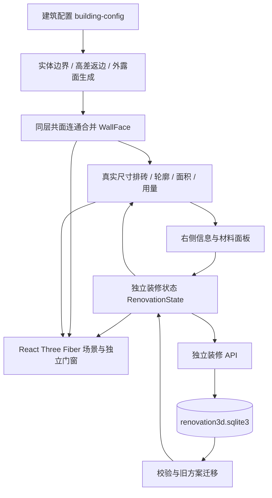

# 3D装修效果演示｜项目上下文与维护文档

> 文档修订：2.9 · 整理日期：2026-11-05（Asia/Shanghai）  
> 对应装修模块：4.1 · 原门窗业务与 API：1.5  
> 工作区：`D:\Workspace\门窗结构分析`  
> 本文仅记录独立装修模块，供后续开发、排查和验收恢复上下文。代码、配置和实际验收结果是最终依据。

## 4.1 窗户批量操作与玻璃升级（2026-11-05）

详见[UPDATE_4.1.md](UPDATE_4.1.md)。复用现有编辑/历史/草稿/报表链路，在`window-actions.ts`按原配置建立匹配基线，新增同类型窗户高亮及修改后批量替换；名称和目标旧报价保留，沿用的已确认报价降为需核对的商家报价。`glass-upgrades.ts`集中管理四种规格及用户给定价格，`WindowFinish`及报价快照增加可选`glassUpgrade`，前后端校验、页面金额、15列Excel、报价依据及方案对比同步。旧方案无此字段时不加价，无数据库迁移。类型属性不包含独立名称及历史报价，匹配包含实际尺寸、分格/开启、颜色、透光、扇数及当前价格/升级配置。

窗户行内小字移至默认折叠依据区；用户选定A后，共享选中颜色改为柔金`#D6B35A`，轮廓3px、点阵不变。226项前端及84项后端测试通过，定向5项补充重跑通过，最终类型/构建与1304×884/模拟390×844数据库副本交互通过；38行下载Excel用Decimal独立复算一致。原几何、采购口径、材料库、历史方案、原业务/模型接入实现及正式两库保持。证据、计价范围及未验证项见更新记录；下方为历史。

## 4.0 模型选中更新（2026-10-26，历史）

详见[UPDATE_4.0.md](UPDATE_4.0.md)。基于3.9，按用户确认的深蓝细线/面点阵方向更新`SelectionOutline.tsx`和`WallMesh.tsx`；单面选中与原高亮均按实际`faceSolids`叠加显示点阵，4CSS像素周期随DPR适配，不覆盖窗洞、不拦截拾取，不进入材料/几何/导出数据。组件仍细轮廓，吸管启用暂隐点阵。页面CSS、场景背景及相机文件与原3.9保持。221项测试、最终类型/构建、桌面/模拟手机/高分屏实际交互与独立像素检查通过；详细保护及发布证据见更新记录。

最新同版本补充：用户要求加粗边框、提高亮度并统一高亮，模块仍4.0。共享轮廓由1.25px增至3px，亮黄色`#FFFF00`点阵透明度由0.8增至1.0；点阵周期及密度保持。面、窗户、组件、同材质高亮和检查定位框共用亮黄色轮廓，检查框说明明确为辅助框。类型检查、生产构建及正式浏览器选中/取消、同材质、窗户及检查定位关闭通过；独立像素核查确认点阵位置和未选中画面保持，另外104个源文件及两库与补充前基线一致。本次未重跑前述221项，历史仅改色记录及最新证据见更新记录。

## 3.9 历史参考图配色修正（2026-10-26）

详见[UPDATE_3.9.md](UPDATE_3.9.md)。以用户截图按钮取样`#3A83F7`作为焦点/轮廓蓝，主按钮/链接使用同色系较深`#246BD6`；大面积表面和文本回到中性黑白灰，蓝色集中于交互。共享主题变量17项，模型材质和既有布局保持。221项前端/类型/构建、定向桌面/模拟手机交互及数据保护检查见交付记录；原业务API1.5、格式1/分面11不变。

## 3.8 历史主题更新（2026-10-26）

详见[UPDATE_3.8.md](UPDATE_3.8.md)。当前3D装修页面`renovation.css`使用16个共享主题变量，统一浅蓝白表面、蓝色操作、中性蓝灰文字及边框阴影，去掉绿/橙装饰。`SelectionOutline`、`WallMesh`、检查辅助框及文字同步蓝色；`scene-environment.ts`使用浅色纯背景，`BuildingScene`移除装饰天空渐变，原日照/相机保持。材料样本、纹理、模型颜色及专业取色色域不改。原门窗分析页样式保持，仅装修入口版本同步；版本/图纸/草稿文件名递增3.8。方案格式1/分面11保持。测试及发布证据见更新记录。

## 3.7 历史增量记录（2026-10-26）

详见[UPDATE_3.7.md](UPDATE_3.7.md)。草稿状态/恢复改为模型区右上角浮层，不占画布高度。`solid-shell.ts`对原结构实体求并集边界，`structural-shell.ts`按当前楼层显隐/拆分派生结构，`StructureMesh`替代独立墙盒、填充体、台阶与楼板渲染；门窗及装修层保持。仅剔除实体内埋/相接/重复面，保留空气侧内墙、洞口、凹角和必要薄封底。默认190实体/6薄楼板→555结构片，相比3.6新增省去295.2312㎡重复/内部结构渲染面积，不改变装修计量。28处原实体交叠由外壳处理，32项资料依据不足继续待核实。

`camera-navigation.ts`集中处理视角、缩放及定位；旧焦点不阻断缩放，近端0.4m，复位以当前可见模型中心为轴。检查辅助框与命令分离；关闭已定位检查恢复整体，显式命令清除OrbitControls残留惯性。221项前端/类型/构建及隔离浏览器回归通过；7份旧方案和完整材料报表与3.6一致。格式1、分面11、136可贴面和原业务API1.5保持，无数据库迁移。已发布至app/dist，现有PID23732继续服务；正式页面、相机恢复像素一致、两类Excel/PNG/SVG及原模型接入只读验收通过，发布后两库与8保护文件一致。实际证据、发布结果及边界见交付记录。

## 3.6 历史增量记录（2026-10-25）

详见[UPDATE_3.6.md](UPDATE_3.6.md)。沿用既有结构，`store/drafts.ts`新增独立草稿目录/快照，`useRenovationStore`管理保存基线、未保存判断、700ms草稿写入、离开补存、恢复/JSON往返及切换确认；加载/默认起点缓存与草稿分离。`edit-history.ts`以引用优先结构比较替代逐次JSON序列化，回退与历史格式不变。

`RenovationApp`统一检查关闭，`BuildingScene`按命令序号移动相机，清除辅助框无需改变当前视角。检查性质和复核进度独立筛选。`purchasing.ts`提供实际计算过程；材料主表追加编号、颜色和箱数，导出3.6元数据请求为13列，旧请求10列兼容。`plan-comparison.ts`按不含价格的外观识别变化，另列单价；同外观采购表显示多分项价格。报价前后端取消20条上限，面板分页查看全部旧记录，Excel完整导出。

`ElevationDialog`将名称更新与几何useMemo分开；`elevation-layout.ts`从实际格号/UV计算基准原点、按模型投影生成各层水平尺寸链，并自动裁出窄面/洞口详图。未核实尺寸/规格仍标记。方案格式1、分面11、136可贴面、原几何源文件保持；无SQLite迁移，原方案/材料不回写。216/80项测试及实际浏览器交互、导出独立核对通过，已发布至app/dist并按既有管理器重启，正式页面/现代Excel/PNG/SVG与原模型接入页面只读验收通过，保护核查一致；具体证据与边界见交付记录。

## 3.3–3.5 三阶段增量（2026-10-23）

沿用3.2、原React/Three.js和FastAPI架构实施；原业务/API1.5、schemaVersion1、分组修订11、136个室外可铺贴面保持。完整交付/测试记录见[DELIVERY_STAGES.md](DELIVERY_STAGES.md)。

- 3.3：`utils/edit-history.ts`、`store/useEditHistory.ts`管理30次会话回退，与方案快照分离；调色/滑动按手势分组，文本控件保留原生快捷键。加载/默认方案清栈，保存不清栈，视图不回退。`utils/model-inspection.ts`和`ModelInspectionPanel`管理证据化检查、定位及复核；`modelReviews`是可选方案字段，签名变化使旧复核失效。相机命令增加包围盒定位。
- 3.4：`purchasing.ts`与`ProcurementDialog`设置可选`purchaseRules`；前后端同一预留/整箱口径。`window-quotes.ts`和`WindowQuoteEditor`管理配置快照、来源及确认失效。`plan-comparison.ts`、`PlanComparisonDialog`与`scene/camera-link.ts`只读比较保存快照，同步相机并定位面/窗变化。后端可选字段集中于`renovation_contracts.py`，旧数据不回写。
- 3.5：`delivery-context.ts`统一软件版本、Asia/Shanghai日期、W窗号与M材料编号；`elevation-layout.ts`直接使用`faceFinishLayout`实际裁砖片段和模型窗框生成四立面，按深度排序，导出PNG/SVG。图片材质共享嵌入并按3D铺贴旋转；不包含3D调色/光照。`ElevationDialog`只读，快速切换立面延迟回收旧Blob URL以避免预览失效。`backend/renovation_delivery.py`增加元数据、材料编号及窗户依据工作表；旧导出请求保持原表结构。

模型检查只对当前实际建模的室外表面进行几何核查；“缺面”相对当前标准面集合，不证明发现所有未建模缺口。真实墙体交接与缺少节点依据均待核实。只有经验证的非许可覆盖记录支持显式清理，不提供未验证的自动拓扑修复。合法门窗洞口、中性结构封底不会列为缺面；封底不可贴、不可选且不统计用料。

采购不复用跨面余料，按规格分别进位；分层采购和全楼合并采购不同。涂料没有罐/箱采购推断。报价来源为用户录入，不做真实商家认证。立面图为当前编辑快照的正投影示意，竖向面以外的水平用料见报表；所有尺寸/材料规格须核实，不作施工放样依据。直接PDF未实现，PNG/SVG满足图片交付。

最终验证：210前端/78后端、类型检查及生产构建通过；隔离数据库交互、保存恢复、旧7方案、两表独立重算、四图解析和相机像素比对通过。3.5已合并发布并经现有服务管理器重启；正式页面及导出只读验收通过。两库记录、表结构和7保护源文件与本次基线一致；详情和证据目录见连续开发记录。

## 3.2 增量记录（2026-10-22）

- 沿用3.1完成6条反馈。仅修改颜色/材料面板、报表布局、一层中性封底及版本/文档；原门窗业务与后端接口不变。schemaVersion1、faceGroupingVersion11及136个可铺贴面保持，无需新增迁移或回写历史方案。
- ColorPicker改为统一的原生popover浮层，限定在右侧栏及可视窗口范围，默认收起；预设、模型吸管、自绘HSV二维面板/色相滑块、RGB/HEX输入均在同一组件内，不再调用不同的系统颜色弹窗。自动外部点击收起，X/Esc关闭并恢复按钮焦点；取色时先收起浮层再点击模型，采样仍含当前光照。砖缝/砖色/漆色/窗框/格栅采用相同尺寸和输入样式。
- 颜色字段统一上行标签、下行33px色块/HEX按钮；砖缝颜色与邻格33px输入框起点/高度对齐。浮层定位不参与表单排版，打开前后字段位置和侧栏scrollHeight保持。
- 材料报表最大1100px，10列按比例固定，缩减无用空白；窗表独立最大1240px，12列按比例固定，移动端保留局部横向滚动。页面报表、用量表的表头/内容/合计均居中，窗表输入值居中；筛选按钮在列右侧定位，不用space-between挤偏标题。最终验收要求桌面无表内横向溢出、表头高度不超过65px。
- 材料面板另保存选中面时的内容指纹和原materialId，不与材料库保存基准混用。实际面参数改变后允许替换原同材质；未变、还原、仅名称变化、无效输入时禁用。执行函数同样检查，成功后更新原材质及比较基准并立即禁用。隔离浏览器保存的方案逐面核对：所有原匹配面完整替换，其余面保持原参数。
- 一层封底不再使用整块entry-plinth矩形。从四面主墙内边界起算，扣除完整墙体厚度、转角实体、格栅与已有0mm室外地面，输出两块不重叠的L形室内面，面积108.9332㎡。门洞按内墙边界收口，门前室外区域不补；仍只在拆分或底座隐藏时显示，中性不可选、不可贴、不参与用料。新增测试覆盖室内点、室外入口点、外墙外侧点，以及与已有地面/墙体/自身重叠为零。
- 验证命令：app目录`npm.cmd run test:renovation`（202通过）、`npm.cmd run typecheck:renovation`、`npm.cmd run build -- --configLoader runner --outDir ../_build-renovation-3.2 --emptyOutDir false`。本轮无后端修改。Browser插件未提供，沿用现有Playwright/Chromium；隔离SQLite副本测试1304×884、1280×884、390×844，覆盖浮层/色板/取色/关闭、按钮门控及整楼范围、两表筛选/下载、保存刷新和原7方案/12材料保持。无应用脚本错误，吸管有已知ReadPixels性能提示；未实测原生Excel或真实手机。3D包gzip315KB，原500KB构建提示仍在。
- 发布前创建新的3.2数据库/保护文件基线与SQLite备份；_build-renovation-3.2已复制至app/dist，保留旧assets。仅静态资源变更，无需重启后端，现有管理PID26692、health=ok/API1.5。正式3.2页面已实测侧栏颜色浮层、修改/撤销后的替换按钮状态、材料表最大1100px及全部单元格居中、12列窗表筛选/默认500元价格/玻璃、两类下载及原模型订阅入口。请求仅GET与只读报表导出，未保存测试方案或材料；下载文件再次核对38樘窗和精确金额。部署后两库原表记录及7个保护文件全部与本轮baseline一致，原7方案/12材料保持。

## 3.1 历史增量记录（2026-10-22）

- 任务覆盖本轮8条批注与红框详情折叠，沿用3.0继续修改。当前136个室外可铺贴面；旧修订10的157面由`editableFacesAtRevision10()`保留，schemaVersion仍1、缓存键不变，分组修订11。旧面按previousFaceId继承材质，裁去相交实体内部与被遮挡部分，不覆盖历史快照。7份真实旧方案在隔离副本恢复、幂等检查通过。
- `utils/model-structure.ts`按相交墙体实际厚度和进退区间补15块转角实体，扣除已有实体、门窗洞口和已补体积；`model-surfaces.ts`按当前完整墙体与填充体裁切装修面，阻止外皮延伸进室内。原building-config.ts、wall-surfaces.ts及return-corners.ts保持。
- 一层标高0增加中性双面封底，仅在底座隐藏或楼层拆分时显示；合拢时共享面归底座，避免重复面。室外天花在拆分或上方盖板隐藏时补中性背面；结构背面均不选、不贴、不计用料。楼板仍为无厚度单面。
- 底座台阶以外壳面替代原长方体渲染，剔除台阶相互遮挡部分及与基础底板同平面重叠的底面。自动检查底面去重、台阶外壳共面不重复；浏览器已查看一层与底座仰视、二层转角俯视截图。
- TileQuantityPanel原生details默认关闭，包含红框内材料用量表/说明、范围排砖和实际材料；主用量卡及购买面积保持可见。更换选面/范围后默认收起。
- ReportFilters改为Excel式勾选菜单，两种报表均需先「开启筛选」才显示表头箭头；支持搜索、全选、清除此列、取消、清除全部。列候选值受其他列条件限制，当前列条件不隐藏自身选项；搜索后确定只取搜索结果中勾选项。合计与导出均按筛选；关闭筛选清空条件。
- 窗户侧栏新增面积单价、每扇单价和扇数，临时清空输入可继续键入。未设价格分别默认500元/㎡和500元/扇，resolveWindowFinish合并旧设置时保留显式价格与0。表格同步编辑并随方案保存。38樘/104.562㎡/28扇的默认演示合计66,281元，不代表用户当前方案或市场报价。
- 独立窗表及Excel新增玻璃列，12列依次为楼层、名称、宽、高、面积、窗框色、玻璃、开启方式、扇数、面积单价、每扇单价、总价。Low-E低/中/高透跟随既有玻璃配置；服务端兼容旧载荷缺省中透，A:L筛选/冻结/打印和格式已更新。开口扇加价仍按扇、金额按十进制四舍五入至分。
- 自定义材料以实际内容去重，忽略ID/名称/时间，包含种类、颜色、纹理/图片、单价与完整铺贴参数，漆面忽略无效砖格字段。前端复用现有记录；后端BEGIN IMMEDIATE事务检查后再插入，并发相同内容只保留一条。既有12份实际内容各不相同，未删除或改写。
- ColorPicker统一覆盖砖色/漆色、砖缝、窗框、格栅色：预设、模型吸管、原生颜色面板、RGB/HEX。Canvas采样只响应单击，拖动不采样，取消/Esc结束且保留选择；采样为光照后显示颜色。软件WebGL出现一次ReadPixels性能提示，已单独记录，不计作应用异常。
- 验证200项装修测试、75项后端测试、TypeScript与生产构建通过。新增几何交口/洞口保护/实体遮挡/底座去重、修订11迁移、500默认报价及0值、玻璃、筛选组合和并发材料去重测试。Browser插件未提供，沿用已安装Playwright/Chromium；1304×884/1280×884工具栏同行，390×844模拟无页面横向溢出，菜单可操作。覆盖折叠/展开、预设/RGB/HEX/面板/模型吸管、重名异名去重、实时窗价/玻璃/扇数、勾选筛选、下载、方案保存刷新及原记录不变；无应用脚本错误。
- 实际下载openpyxl复核：筛选窗户3.60㎡×750＋2×700＝4,100元，G列高透Low-E、I列2、J列750、K列700、L列4100，筛选A6:L7；材料深灰岩板260.44304㎡、692片，分区预购730片/94,608元，整楼合并预购727片/94,219.20元，保留分区与整楼采购口径差异。原生Excel及真实手机未实测。
- 生产数据保护：两个库全部原表记录及7个保护文件与本轮baseline一致，原门窗4项目/5资料/11评估/12来源，装修7方案/12材料；所有持久化写入验收仅在隔离副本。_build-renovation-3.1已复制至app/dist，保留旧assets，现有service.ps1 restart返回RUNNING/health=ok，管理PID26692。正式页3.1、原health/API1.5、38樘窗的默认价格/玻璃、筛选菜单、两类Excel下载、原模型订阅入口均通过独立浏览器检查，无应用脚本错误；正式请求仅GET及只读导出POST，未保存验收方案/材料。部署后保护核对仍全部一致。3D包gzip313.67KB，仍有超过500KB构建提示。

## 3.0 历史增量记录（2026-10-22）

- 本轮按用户4条浏览器批注及3项正文要求增量完成：底座/一层严格划分、单面楼板、同材质高亮、日照滑块、室内禁选禁贴、材料表覆盖统计/表头筛选、独立窗户统计/导出、本文更新。原门窗/API仍1.5。
- `utils/model-surfaces.ts`保留2.9几何作为历史只读基线，生成当前157个室外可编辑面（旧168面）。地面界定沿配置一层标高0mm，水平交界面和下方归base，分别控制显隐/应用/统计，拆分时底座不动、一层及以上依序上移。墙面只取外朝向和明确建模的室外阳台/露台围护；室内墙背及结构封底不进入可编辑面集合。外墙包括凹凸缝的垂直窄面和门窗返边；室外天花单独为ceiling，室外地面为floor。横向窗台、栏墙压顶等外露小面按朝向归外墙返边或室外顶面/地面，不生成室内装修。
- 原板厚180mm仅留在历史配置；渲染slab用双面可见单平面，去掉板边可编辑皮肤与房间墙体施工顶帽；阳台天花抬到对应楼层边界，原板带的墙体补齐并对成员逐块扣重，避免重复网格闪烁。结构封底不响应选材，室内中性结构仅遮挡点击，不可选中或覆盖材质。模型尺寸及旧建筑配置没有重写。
- `faceGroupingVersion:10`，schemaVersion和缓存键保持；`validateRevision9State`保留历史验证入口。旧状态先按9恢复原面材质，再由previousFaceId映射到新面，移除的结构面不再进入当前面映射，原数据库快照不变。历史算法测试继续按原发布修订回归，新3.0测试验证当前迁移/几何规则。
- 同材质高亮读取选中面的实际materialId，遍历整楼当前面；半透明琥珀覆盖与轮廓均不接收点击，不改材质/价格/方案，隐藏区域保持隐藏，可在面板或场景提示取消。
- 日照6–18时，每步0.25小时。`utils/sunlight.ts`给出东→南→西的示意太阳轨迹，驱动定向光、阴影和晴天背景太阳；sunHour为可选状态字段，兼容旧方案默认12时。没有经纬度/日期输入，明确不作真实日照计算。
- 材料表增加底座分区，仅传入当前室外已覆盖面，结构/室内不计。ReportFilters为全部列提供文字包含、数字精确/比较/区间筛选；筛选后页面汇总和导出一致，空结果禁用导出。分层/整楼切换清空筛选避免跨口径混用，导出依当前页筛选保留匹配分区行、服务端独立合并整楼采购。仍为两表静态数值快照。
- `utils/window-report.ts`、WindowReportDialog、`backend/renovation_windows.py`和POST `/api/renovation3d/window-report/export`独立于材料表。11列表头：楼层、名称、宽、高、面积、窗框色、开启方式、开口扇数、面积单价、开口扇单价、总价；全部列筛选。初始38樘/104.562m²；仅window，不含door/balcony/screen。名称、扇数、价格可编辑并随方案保存；面积与窗框色沿实际窗模型/窗框设置，默认扇数来自窗格示意，允许修正，开启证据仍待现场复核。
- 窗价=面积×面积单价+开口扇数×每扇加价。面积价未设、或有开口扇但未设每扇价时整樘待报价，合计仅包含完整报价且显示未报价樘数；明确输入0可报价为0。无开口扇无需额外单价。逐樘四舍五入到分，服务端Decimal独立复算。新窗字段均可选，无数据库迁移；严格拒绝负价、非整数扇数、无效颜色、重复行等。单独.xlsx仅「窗户统计」一表，保留筛选/冻结/打印及长名称行高，名称按文本写入，不打开数据库。
- 金额复核修正：新增utils/money.ts，按十进制整数乘积精确四舍五入到分，避免JS浮点误差；窗户8.1m²×4.25元的正确金额34.43元（旧浮点写法可能34.42）已在正式浏览器及下载Excel对账。材料费同样使用该算法，与服务端Decimal口径保持一致。
- 验证：195项装修测试、72项后端测试、TypeScript、生产构建通过。几何测试包括同面成员去重、跨面共面不重叠、底座交界归属/显隐/拆分、移除板边与房间施工帽、旧9到10的材质一致和幂等。7份实际历史方案在隔离库副本只读恢复并生成报表，未改原状态；原7份快照在隔离保存新方案后仍逐项不变。
- Browser插件未提供，使用现有Playwright/Chromium测试1304×884、1280×884和390×844模拟尺寸：日照08/16时阴影变化；底座和一层分别显隐；室内墙面/地面点击不产生可编辑选择；同材质高亮/取消；楼层拆分单面封底；材料/窗户表筛选、空结果禁用、实际下载、503失败重试、Escape焦点恢复；窗户名称/数量/单价保存方案后刷新恢复。最终页面无非预期应用错误；桌面工具栏所有组中心Y86且无溢出，窗表11列在1304宽度同时展示，手机表内局部滚动且页面无横向溢出。
- 两个实际下载文件及正式页完整导出以openpyxl读取并独立对账：材料过滤结果/全量区域及整楼采购、窗户面积和按扇加价、待报价、金额小数边界、数值类型、筛选/冻结；Artifact Tool只读导入并渲染过滤后的材料与窗表，人工查看版式。默认新模型净铺贴959.222296m²、2374片、整楼预购2494片，演示材料价238349.97元；这些是默认状态校验值，不冒充用户当前缓存方案。未实测真实手机/原生Excel；日照为外观预览，价格均须用户填入和复核。
- 发布：_build-renovation-3.0复制至app/dist并保留旧资产；原service.ps1重启后正式8768页面3.0、原health/API1.5正常，两类导出POST与原模型配置界面通过。正式检查只GET及只读报表导出，窗价试填未保存。两生产库原表记录及原模型/建筑配置/旧表面/转角保护文件与本轮基线哈希一致，仍7方案/12样式。3D包gzip约309KB，仍有500KB构建提示。

## 2.9 增量记录（2026-10-22）

- 用户确认新增「材料与价格表」：两页签为分层明细／整楼汇总，10列表头为区域、材料、类型、纹理规格、净面积、排版片数、预购片数、预购面积、单价、材料费；分层小计与各采购口径合计保留。点击材料查看材质／上传图、颜色、完整铺贴参数与对应面的用量。当前编辑方案全部楼层参与，显隐不影响统计。
- utils/material-report.ts计算报表。几何／faceGroupingVersion9均不改动；跨室内侧／露台的面，实际面积按成员归区，跨区砖格按覆盖面积最大区域归属并仅计一次，平局按分区ID固定顺序。全楼材料／规格聚合沿用tileQuantityKey与purchaseTiles，同种朝向不同也按规格合并采购，净面积和排版／预购片数与既有统计一致。
- 瓷砖预算按预购片数×单片面积×方案单价；漆面按净面积×单价，无片数。各材料行四舍五入到分后相加；分区各自加5%预留，整楼先同材同规格合并再预留，故采购总量和金额不必等于分区采购之和。价格沿用方案，预设为演示估算，不含人工、辅料和运费。
- MaterialReportDialog使用原生dialog提供模态与键盘行为，关闭恢复工具栏焦点；空名称禁用下载，失败显示错误并可重试。详情及10列表格在手机内局部滚动，页面不横向溢出。新按钮仍保持桌面工具栏同行，1304/1280宽度及立面范围附加控件实测无裁切。
- useRenovationStore只新增当前方案ID／名称的临时元信息，在加载／保存／改名／默认方案时更新，用于报表默认名称；不改历史或localStorage键和状态schema。报表名称可单独改，刷新仅有状态缓存时默认「当前编辑方案」。报表每次打开读取当前编辑状态，材料／价格修改后立即反映。
- 新增backend/renovation_report.py与POST /api/renovation3d/material-report/export。载荷仅含所需材料元信息及分区面积／片数，不发送材质图片；严格验证引用、重复行、范围及漆面规则，服务端独立汇总及计算采购金额。使用已安装openpyxl生成两张带样式、筛选、冻结及打印设置的.xlsx，不打开数据库。数字保持数值类型，材料名称按文字写入，包括“=”开头名称。文件为当前方案数值快照，含导出信息和口径，不提供Excel内动态预算公式，不回写方案。
- 验证186项装修测试、67项后端测试、类型检查和生产构建通过。新增用量对账、跨区计数、漆面／单价及分币舍入、导出载荷、两张表的独立期望值、真实.xlsx结构／数值格式／名称安全、长中文名称自适应行高、非法或重复输入拒绝及两库哨兵不访问验证。Playwright覆盖双页签、详细参数、实际下载、空名称、模拟503重试、Escape／焦点、隐藏层、手机表内滚动；另验证999.25单价变更进入报表，历史方案名称和精确金额跟随。下载两表数值与页面对账，Artifact Tool导入／渲染检查版式；尚未原生Excel或真实手机验收。
- _build-renovation-2.9复制至app/dist并使用service.ps1 restart发布。正式页面报表打开和Excel下载通过，仅增加只读导出POST，其余正式回归GET。两个生产库全表原记录及4个模型保护文件、building-config.ts／wall-surfaces.ts／return-corners.ts哈希与本轮前一致；装修7方案/12样式。原门窗/API1.5与168个面保持。3D包gzip约303KB，仍有500KB构建提示。

## 2.8 增量记录（2026-10-22）

- 用户反馈：桌面工具栏右侧“应用范围/背景”换行；前立面0.61m²水平返边在转角仍有碎片/重叠观感。
- 桌面CSS只调整工具栏为nowrap、紧凑间距及留白，允许窄桌面局部横向滚动；手机原分行保留。实际1304/1280宽度下各组中心Y均86px、scrollWidth等于clientWidth；“所选立面”附加选项也不造成换行或裁切。
- 根因是返边的裸墙端点与平移8mm后的完成面端点不一致，属于真实小缺口而非上一版共面重叠审计范围。新增utils/return-corners.ts：只处理同楼层/同高度/同朝向、背墙垂直且端点距离不超过tileDepthMm的水平返边；续接至共同完成面角点，扣除实体遮挡和原表面后统一求并集。保留真实不同平面、层间线及更大间隔。补丁不作为独立选面渲染。
- 选面170→168，用户标记的前条、两侧条和转角共用一个ID，净面积约1.62m²。新补齐7616mm²，外露总面积1028.471136m²；旧170面所有点保留，成员面积无重复，全楼同向/反向名义面及实际渲染深度的共面重叠为0。
- 分组修订9。buildingFacesAtRevision8精确保留2.7的170面，夹具renovation-2.7-faces.json；validateRevision8State保留旧迁移契约。修订8→9按完整铺贴的旧覆盖面积选择最大者统一，平局固定排序；不改历史快照。修订6/7的既有路径继续保留，当前每面仍一个完整铺贴。
- 测试182项装修、62项后端、类型检查、生产构建通过。新增2.8测试覆盖实际角部、完整旧面覆盖、精确新增面积、全楼及成员不重叠、不同高度/平行背墙/9mm间隔不误合并，以及修订8迁移幂等和整面替换。旧2.7精确几何契约改用明确的修订8入口，原实体遮挡测试继续检查当前全部面。
- Playwright使用隔离库加载2.8构建；1304×884/1280×884验证工具栏，实际点击前条、转角、侧条均为同一面。继续验证独立显隐、样式高亮与连续改名、修改/撤销/保存门控、图片上传、无效输入保留模型、修订9保存刷新和旧数据库快照不变；390×844模拟无横向溢出，应用控制台无错误/警告。7个生产历史方案另只读迁移并验证输入不变、每面单一铺贴及幂等。
- 发布产物_build-renovation-2.8复制至app/dist，保留旧assets，service.ps1 restart。原门窗业务/API仍1.5。重启后两库全部原表记录和backend/main.py、providers.py、config.py、subscriptions.py哈希与本轮开始前一致；装修仍7方案/12样式。未实测真实手机；3D包仍有500KB提示，gzip约299KB。

- 正式2.8页面只读复核通过：工具栏同行，点击前条/角部/侧条均选中同一返边面；旧梁选择、改名打开/取消和原门窗模型/视频入口回归通过，全程仅GET。

## 2.7 增量记录（2026-10-22）

- 任务已沿用2.6及中断前2.7代码完成。原门窗1.5的模型订阅接入、原API选项和单条96分钟视频索引保留；本轮没有改动其业务代码。
- 新增 `utils/coplanar-faces.ts`，按物理平面、实际层高范围及连通性求并集。来源类型、facade标签、室内/露台分组不再构成选面边界。配置墙体保留原参数；竖向外露楼板边按实际层高重新归属，修复10处与下层墙体共面却因旧楼层字段未合并的边界。选面313→170，总外露面积1028.46352m²；层间线、不相连区域及不同平面仍独立。矩形所有权去重；全楼同向/反向共面面积重叠均为0，注入重复及部分重叠输入可去重。
- `mergedFaceIds`记录确切修订7来源，成员保留viewGroup；`visibleFace`按显示开关裁出成员，但保持统一选面ID及铺贴。整个逻辑面的材料和用量保持完整，界面提示跨室内/露台面换材质会作用于整个面。
- 分组修订升为8。验证先按准确修订6/7恢复，再按各完整铺贴实际覆盖面积选择最大者并统一；相同外观与完整参数合并累计，平局按固定指纹排序。当前 `faceFinishes`为每面显式完整覆盖、`preserveZoning:false`，`faceRegionFinishes`为空。修订8渲染始终只有一个铺贴。历史数据库快照不回写；`buildingFacesAtRevision6/7`和`validateRevision7State`保留历史兼容契约。
- 合并后超出原墙局部范围的面仍沿原砖格基准延伸，允许负行/列索引，防止缺铺；覆盖、UV和世界坐标基准已验证。
- 材料指纹包含种类、颜色、纹理/图片、单价和完整铺贴参数（漆面忽略砖格）；自动修改名、复制ID不计入修改。材料面板在初始/选面/选择样例/成功保存时更新基准；改参数、手动改名或上传图片后可保存，撤销后禁用。保存函数另有并发及无修改保护；同名同内容重复提交拒绝。已保存材料高亮、继续改名保留，名称没变时不能保存改名。
- 验证：177项装修测试、61项后端测试、TypeScript和生产构建通过；7条真实历史方案只读恢复、输入不变及幂等检查通过。旧分区铺贴/旧ID断言明确标记修订7历史契约，新增2.7测试覆盖当前完整建筑。Playwright使用隔离DB及独立端口加载2.7构建，覆盖梁/四层共面选取、分组显隐、整面换材、高亮/两次改名、保存条件与撤销、旧混合方案恢复、新方案保存刷新、无效输入和图片上传保存；桌面1304×884、模拟390×844无应用脚本错误/警告、无横向溢出。
- 本轮前后两个生产库所有原表全记录哈希一致，门窗4项目/5资料/11评估/12来源，装修7方案/12样式；四个保护文件backend/main.py、providers.py、config.py、subscriptions.py不变。后端renovation.py仅接受新增修订8。实际写入验收均在隔离库。
- 发布仍使用_build-renovation-2.7复制至app/dist并通过service.ps1 restart重启；不删除旧assets，兼容仍打开的旧页。仅监听127.0.0.1:8768，PID见data/service.pid，日志data-server.log/data-server-error.log。3D包gzip约299KB，仍有500KB构建提示；真实手机和真实付费模型账号未验收。

- 正式部署复核：service.ps1 restart返回health=ok；正式装修标题2.7，原业务/API1.5。生产只读浏览器点击梁上下两点、改名打开/取消、原模型API/订阅各4类及唯一视频10章节通过；全程仅GET。部署后全部原表记录及4个模型保护文件哈希仍一致。

## 2.6 增量记录（下方2.5及更早内容为历史）

- 楼板底面及其厚度范围内的侧向接缝不再将墙面切成独立小条，仅保留层间线及其他实际块面边界。楼板实体、外露面与面积仍参与几何计算。一层东侧白梁的3300–3800mm范围为一个500mm高选面，原3620–3800mm的180mm条不再单独选择。运行选面340→313，外露总面积保持1028.46352m²。
- 分面修订升为7，schemaVersion及建筑ID不变。`buildingFacesAtRevision6` 保留准确的2.5分面供恢复使用；`utils/face-compat.ts` 将被合并的旧面保留为材质分区。即使旧340面分别使用不同铺贴，也保留原区域和参数；单击选中合并面后替换会统一此面。恢复过程不重写缓存或数据库快照。服务端仅增加接受修订7。
- 自定义材质卡的高亮依据选中面实际材质与铺贴参数；预设/自定义分类按材质身份切换，避免外观相同的保存样式误占默认材质。一个历史面有多个铺贴时，可分别标出匹配卡。
- 已保存材质卡新增铅笔按钮，可再次打开名称表单并连续改名；复用现有 PATCH `/api/renovation3d/tile-styles/{id}`。只更新样式名称及更新时间，材质、铺贴、ID、创建时间和历史方案保持。
- 数值验证：170项装修测试、60项后端测试、类型检查和生产构建通过。新测试验证楼板条合并、原面积/选面覆盖、340个旧面独立参数恢复及幂等、只改原上条不会重涂下部，以及高亮参数匹配。
- 浏览器实测：正式页面点击3500/3700mm都选中同一500mm梁，改名表单可打开/取消，全程仅GET。隔离库实测选面高亮、分类跟随、同条样式连续两次改名、刷新和修订7方案保存恢复；1304×884与390×844模拟通过，无应用脚本错误/警告。生产7方案只读恢复、两库原表全记录哈希及模型配置代码保护核对通过；实际改名和新方案写入只发生在隔离库。
- 模型订阅接入仍使用原门窗1.5实现，不在此模块修改。详细步骤与构建提示见README的2.6记录。

## 1. 文档归属与当前状态

| 文档 | 负责内容 | 使用方式 |
| --- | --- | --- |
| 根目录 `PROJECT_CONTEXT.md` | 原门窗结构分析业务的决策、证据规则、模型与审查流程 | 保持原文档归属；其中日期和服务状态是当时快照 |
| `renovation-docs/PROJECT_CONTEXT.md`（本文） | 3D装修模块的当前架构、功能、决策、待办及维护记录 | 继续装修开发时优先阅读 |
| 根目录 `README.md` 的“独立增量模块”章节 | 装修操作说明、运行方式及各版本验证记录 | 查用户操作及具体历史验证范围 |
| `renovation-docs/MVP-1.0.md` | 首次开发前的设计与1.0实施结果 | 历史方案；不能当作2.5现状使用 |
| `renovation-docs/DIMENSION_SOURCES.md` | 永久PDF尺寸依据、用户校订、模型推导与未标施工节点 | 后续调整尺寸先核对本表及原图 |
| `renovation-docs/baseline-*.json` | 接入装修模块之前的原业务保护基线 | 原文件、数据库内容回归核对依据 |

**历史2.5结论（当前以3.0增量记录为准）：2.5将四层窗上封口梁及其返边、顶底外露面归回四层；隐藏“露台／屋顶”时，该梁仍完整保留并可选中。全楼交口取消同来源／返边的整类跳过，并按背后墙体转向拆开共面的环形梁底。** 当前223个墙／表面对象、221个基础面、340个运行可铺贴面，其中24个属于露台／屋顶组；结构楼层仍4。配置中相互垂直面之间的有限交线残留为0，全部旧选面面积守恒，总外露面积1028.46352m²（不是建筑面积或净贴砖采购面积）。分面兼容修订6、schemaVersion仍1。165项装修测试、46项后端测试、类型检查及生产构建通过。6旧方案及2.4全部239面独立覆盖快照可恢复且幂等，两库原记录／schema与25保护文件不变；没有新增或覆盖生产方案。

本文最初在1.8文档整理时建立；下方保留历次记录，新增1.9至2.5实际实施、验收与历史阻碍。原门窗业务上下文不在本文更新。

### 快速恢复

- 装修入口：`http://localhost:8768/renovation3d.html`；原业务入口：`http://localhost:8768/`。
- 前端主目录：`app/src/renovation3d/`；装修路由：`backend/renovation.py`，报表与材料内容指纹分别见`renovation_report.py`、`renovation_windows.py`、`renovation_styles.py`。
- 建筑ID：`pdf-residence-1`；配置单位：mm；方案格式 `schemaVersion: 1`，当前分面兼容修订 `faceGroupingVersion: 11`。
- 装修数据库：`data/renovation3d.sqlite3`，与原业务 `data/windows.sqlite3` 分离。
- 2026-10-19按2.5配置计算：223个墙／表面对象、221个基础完成面、340个运行可铺贴选面、51个洞口、13个其他构件（含1个透光格栅）；其中123个生成的外露表面、45个高差返边。洞口包含窗、门、阳台及格栅敞口，不是51扇窗。
- 后续任务从现有3.2继续，保留历史方案及原业务；不要重新搭建平台。下方旧版决策须以文首3.2及其后增量记录为准。

## 2. 产品范围与关键决策

| 主题 | 当前决定 | 原因／边界 |
| --- | --- | --- |
| 业务隔离 | 装修是独立页面、独立状态、独立接口前缀、独立数据库 | 不复用门窗项目、资料、评估ID，不读取门窗分析结果驱动装修 |
| 最小接入 | 原页面只增加新标签入口；后端主入口只挂独立装修路由；Vite多入口构建 | 保留现有页面、业务逻辑、接口和数据 |
| 技术栈 | React + TypeScript + Three.js + React Three Fiber + drei，沿用Vite及FastAPI宿主 | 独立场景包；原业务页面不导入装修场景 |
| 第一阶段 | 住宅外立面装修，包括室外地面、露台内墙和外露顶底面 | 室内装修、家具和任意建筑编辑尚未实现 |
| 尺寸依据 | 用户已明确“按PDF标注推进”；效果图用于块面分割、窗型及外观判断 | 未标尺寸不能按效果图猜成实测值；冲突和假设保留待核实 |
| 几何依据 | 灰白分界是实际墙体进退；60mm表示法向深度差 | 不把灰面做成白墙上的第二层覆盖皮，不在每层任意添加凸条 |
| 面的划分 | 同楼层、同平面、同深度且连通的面合并；高差、真实转角及不连通部分分开 | 选面、面积和换材质尽量对应真实外露块面；不按裁砖碎片分面 |
| 柱体表达 | 取消额外叠加柱体；保留有依据的墙体及洞口边墙 | 不能把实际洞口边墙一并删成缺口 |
| 参数集中 | 尺寸、标高、洞口、分色深度、材料及场景约束放配置层 | Three.js组件负责渲染，不散写建筑尺寸 |
| 真实排砖 | 毫米坐标计算每块砖与裁片，扣洞口、边界、层缝 | 不以Texture缩放或repeat代替实际排版 |
| 上下对缝 | 四外立面采用世界坐标基准；内侧和地面采用局部基准 | 同规格、同方向、同起铺方式才有相同对缝条件 |
| 修改方式 | 有效参数实时预览；单面、楼层、立面、全楼及原同材质批量替换 | 非法或超限输入保留上一次有效模型 |
| 门窗 | 独立对象、独立窗户参数面板及 `windowFinishes` | 选窗不能进入墙面换砖；Low-E为视觉预设，不是性能计算 |
| 保存 | 每次保存生成新方案快照；历史可加载、重命名；材料样式独立保存 | 不覆盖原历史状态；重命名仅更新名称和时间 |
| 兼容 | 稳定墙ID、面ID和洞口定位；恢复旧方案时补新面、迁移分面 | 恢复不回写旧快照，不丢弃已有自定义材料或原分区铺贴 |
| 验证 | 数值几何检查与浏览器可视检查共同使用 | 测试和构建通过不能证明全楼视觉几何正确 |

### 早期方案中已调整的决定

1. 1.0只有浏览器缓存且不新增后端；后续用户要求历史方案，现已授权增加独立 `/api/renovation3d` 路由和装修SQLite库。仍不得接入原门窗业务数据。
2. 早期底部工具栏已按用户要求整合至顶端，提示改为场景内无背景悬浮文字，避免占用模型高度。
3. 1.0局部排砖未实现跨楼层对缝；现已增加四立面共享 `tileDatums`。
4. 早期二层阳台地面8.7514m²是未扣除前栏墙覆盖区域的历史值；1.7后，二、三层当前净模型地面均为7.6514m²、外周长14.1m。

## 3. 已完成能力及确认边界

| 能力 | 已实现 | 仍需区分的边界 |
| --- | --- | --- |
| 建筑配置建模 | 四层墙体、楼板、退台、门窗、栏杆、屋檐、女儿墙、平台及阶梯 | 不是自动从任意图纸生成BIM；部分定位和厚度为演示假设 |
| 场景操作 | 旋转、缩放、平移、复位；四立面；楼层隐藏与拆分；晴空／素色背景 | 右键平移、无WebGL及不同设备不能用历史记录替代本轮实测 |
| 选取反馈 | 橙色轮廓；单击选取；拖动或超过350ms的长按不换选；空白取消 | 隐藏楼层不参与渲染及拾取；不得出现内部裁片重叠描边 |
| 面信息 | 包络长宽、净铺贴面积、外周长、洞口周长、颜色、进退深度、实际材料 | 不规则面的长宽不是可直接相乘的净面积；层缝会影响净铺贴口径 |
| 瓷砖编辑 | 尺寸、颜色、纹理、方向、起铺、缝宽、缝色；上传真实砖图；实时重排 | 不包含错缝、碰角工艺、专用阳角条和施工级余料优化 |
| 单面及批量替换 | 当前面、楼层、立面、全楼；一键替换全楼原同材质 | 批量依据是进入编辑时的原材质；不能拿预览后的新材质反查 |
| 漆面 | 连续纯色；隐藏砖规格和砖缝输入；按面积估价 | 不统计砖数；没有按涂布率、遍数推算涂料升数 |
| 门窗 | 分格／开启图示；窗面积、周长、宽高；独立窗框颜色和Low-E低／中／高透 | 门是独立门对象；玻璃不是实测VLT或热工仿真，未实现真实开启动画 |
| 数量统计 | 当前范围、全楼同种、全楼全部；需砖、裁砖、窄条、5%预计购买量 | 全楼包括隐藏楼层；不同面不复用余料；不是施工采购保证 |
| 价格 | 材料元/m²单价、手动编辑、净面积估价，随方案保存 | 默认价格为演示估算，不含人工、辅料和损耗 |
| 历史和样式 | 方案新快照、加载、重命名；命名瓷砖／漆面样式，跨方案复用 | 样式与方案分别保存；尚无方案删除、导出UI或云同步 |

### 当前主要建筑参数与未确定项

| 参数 | 当前配置 | 依据／状态 |
| --- | --- | --- |
| 楼面标高 | 0、3800、7100、10400mm | PDF标高；一层高3800，其余各层3300mm |
| 屋顶／女儿墙顶 | 13700／14300mm | 配置对应PDF立面 |
| 装修共同外缘 | 10320×12320mm | 用于立面统一；各层原平面10200／10260／10320等差异仍保留待复核 |
| 灰白法向差 | 60mm | 按立面及用户确认的效果图分色关系 |
| 一层顶部白色环梁 | 高500mm、四周连续 | 用户标注明确；不得误改为每层连续凸梁 |
| 演示层缝 | 20mm，包含屋顶女儿墙底线 | 用户明确要求；展示尺寸，不等同施工节点确认 |
| 前廊／阳台 | 名义深1600mm；二层错位后1540mm，侧净敞口1240mm | 按400×300角墙收口；一层格栅1200mm使后墙收至Z4600、左返1560、右侧围护1500，均为当前完成面定位推导，详见尺寸依据表 |
| 一二层南角墙／一层格栅 | 角墙南400、侧300；格栅1200×3300×200mm | 用户确认及PDF第8页净口1200；杆／框40、目标净距80仍未有完整施工节点 |
| 四层退台／屋檐 | 西段退入2200mm；屋檐相对主体出挑60mm | 平面和立面组织；轴线与外缘换算仍待复核 |
| 顶层大窗 | 3960×2700mm；X940–4900，Y10400–13100，正面Z540 | 用户确认仅靠左侧返墙边内缩240mm，其他边不动 |
| 厚度参数 | 上层墙260、退台返墙200、板180、栏墙160、窗框深100mm等 | 节点演示参数，不可当作整套施工详图已确认 |
| 基板 | 12320×14320mm，较建筑共同外缘四周扩1000mm | 用户展示要求 |
| 入户平台／阶梯 | 通长平台外伸900；阶梯宽1800、踏面300、每级150，共450mm高差 | 效果图下的暂定尺寸；两个踏面与平台形成三级高差 |
| 三层侧门 | 900×2800mm；下口为楼面0mm | 用户要求上沿与相邻窗600+2200=2800mm对齐；宽900及沿墙定位仍为未标演示值 |
| 后西灰L楼层 | 当前按四层大窗1000–2500mm高度带处理 | 截图／窗型与用户“三层”文字指代冲突仍待确认 |

## 4. 架构与目录

### 4.1 数据流



门窗原业务只提供导航入口；图中不包含原 `windows.sqlite3`、上传识别、模型服务或评估流程。

### 4.2 目录职责

```text
app/renovation3d.html                独立HTML入口
app/src/renovation3d/
├─ main.tsx                         独立React挂载
├─ renovation.css                   r3d命名空间样式及响应式布局
├─ config/
│  ├─ building-config.ts            建筑尺寸、楼层、洞口、分区、构件、默认材料
│  ├─ window-config.ts              窗格、开启图示依据、Low-E视觉预设
│  └─ scene-environment.ts          晴空、素色、地面与环境参数
├─ components/
│  ├─ RenovationApp.tsx             场景/面板协调、选取与应用范围
│  ├─ ViewControls.tsx              顶端工具栏
│  ├─ MaterialPanel.tsx             信息、材料、实时编辑、估价与样式
│  ├─ TileQuantityPanel.tsx         三种范围用量及购买量
│  ├─ WindowPanel.tsx               独立窗户参数
│  └─ HistoryPanel.tsx              方案加载、重命名
├─ scene/
│  ├─ BuildingScene.tsx             Canvas、相机、楼层、天空、交互门控
│  ├─ WallMesh.tsx                  墙实体、完成面与门窗挂接
│  ├─ OpeningMesh.tsx               独立门窗框、玻璃及开启图示
│  └─ SelectionOutline.tsx          面轮廓和结构对象描边
├─ materials/tile-material.ts       材质纹理与上传图片呈现
├─ tile-layout/layout.ts            毫米网格、矩形裁切、原砖UV
├─ store/
│  ├─ useRenovationStore.ts         状态、缓存恢复及历史动作
│  ├─ plans-api.ts                  独立方案API客户端
│  └─ styles-api.ts                 独立材料样式API客户端
├─ types/index.ts                   配置、面、铺贴、材料及状态类型
└─ utils/
   ├─ wall-surfaces.ts              分面、合并、排砖适配、计量
   ├─ outline.ts                    矩形并集、外轮廓及洞口边线
   ├─ relief-returns.ts             60mm实际高差返边
   ├─ exterior-surfaces.ts          从实体边界生成外露面并扣邻接遮挡
   ├─ tile-quantities.ts            原砖格去重、分材质汇总、5%损耗
   ├─ finish-actions.ts             单面/同材质替换、样式导入、价格
   ├─ window-finishes.ts            窗格生成及窗户材质校验
   ├─ selection-click.ts            单击与拖动/长按区分
   ├─ validation.ts                 方案校验、迁移、图片处理与预算限制
   └─ units.ts                      mm到Three.js米制换算及标签
backend/renovation.py               独立路由、请求校验、SQLite持久化
app/tests/renovation*.test.mjs       前端算法、状态、接口客户端回归
tests/test_renovation.py            独立后端与临时数据库测试
renovation-docs/                    本模块文档及原业务接入基线
```

### 4.3 配置与状态的分工

| 数据 | 关键字段 | 职责 |
| --- | --- | --- |
| `BuildingConfig` | `id/unit/floors/walls/parts/viewGroups/materials/defaultTile/tileDatums/openings/scene` | 建筑事实、假设参数及默认值，不存用户方案 |
| `Floor` | `id/elevationMm/heightMm/footprintMm/evidence` | 楼层标高、原图包络与依据 |
| `Wall` | `originMm/rotationY/rotationX/widthMm/heightMm/thicknessMm/finishZones/openings/surfaceCuts` | 配置实体或独立表面的源描述 |
| `FinishZone` | `materialId/offsetMm/backMm/faceKey`及矩形边界 | 配色区法向进退及独立命名；可选backMm控制真实背面位置，本轮400×300角墙使用-360至-60构成300mm厚度 |
| 表面标记 | `surfaceOnly/surfaceKind/topCoveredMm/claddingMm` | 区分结构体、地面、内墙、高差返边与外露面；避免重复实体 |
| `Opening` | `id/kind/x/y/width/height/evidence/design` | 墙局部二维洞口；真实窗框、玻璃由独立对象生成 |
| `WallFace` | `id/members/rects/holes/zones/sourceWallIds` | 派生可选面；一个面可以来自多片共面源墙 |
| `Finish` | `materialId/widthMm/heightMm/direction/groutMm/groutColor/alignment/preserveZoning` | 铺贴参数，不负责建筑尺寸 |
| `TileMaterial` | `id/name/color/texture/image/pricePerM2/kind` | 材料样例；`kind: paint`表示连续漆面，旧值缺省仍按砖处理 |
| `RenovationState` | `buildingId/materials/finishes/faceFinishes/faceRegionFinishes/windowFinishes/partColors/hiddenFloors/hiddenGroups/exploded/background/faceGroupingVersion` | 用户装修方案，独立保存 |
| `Evidence` | `page/status/note` | 页码、图纸依据或pending状态、冲突及假设备注 |

坐标约定：X向东、Y向上、Z向南；前=南、后=北、左=西、右=东。配置用mm，渲染边界通过 `m/metres` 转为米。不要在同一坐标表达中混用mm与米。

`finishes`保存墙级兼容值；`faceFinishes`覆盖当前面；`faceRegionFinishes`保留合并面中的历史来源分区；`windowFinishes`只控制窗框与玻璃；`partColors`仅接受配置中格栅ID及HEX颜色。材质ID与对象ID引用必须校验，不能凭页面是否显示成功判断保存格式正确。

## 5. 几何与真实排砖的实现思路

### 5.1 先实体、后外露边界、再完成面

1. 从配置建立墙体、洞口、板、梁等源对象，使用实际厚度和法向进退。
2. `surfaceCuts`裁掉源墙不应存在的部分；`topCoveredMm`控制被楼板覆盖的实体墙顶。
3. `reliefReturns`沿高低完成面交界生成60mm转接表面，扣洞口和转角重复。
4. `exteriorSurfaces`计算墙／构件实体边界，扣邻接体、门窗背后区域、已有完成面及共面重复；内部房间背面和埋地底面不作外装修面。
5. `buildingFaces`合并同层共面的连通区域并拆分不连通部分；`members`记录来源，服务历史铺贴兼容。
6. 2.2在合并基础面后调用`intersectedFaces`：扣邻接实体掩模、沿有限交线分隔；再用`splitAtLevels`在楼层及13700mm层缝分为独立面，保留UV与旧ID继承线索。
7. `splitViewGroups`按配置来源将跨四层／露台的成员分为独立可见面，保持UV基准、面积和旧ID继承线索。
8. `WallMesh`依据`wallBodies`单独渲染实体；`FaceMesh`仅渲染完成面与描边，避免剔隐藏面时误删结构。渲染、选取和计量使用同一运行面集；轮廓用并集边界，不显示裁砖碎片内部边。

**重要限制：外露面生成器只负责边界，不能自动修复源实体互穿。** 修正交口应先找出占用空间相交的实体，再调整源边界；增加补面、颜色覆盖或深度偏置不能证明实体已经正确。

### 5.2 排砖计算

1. 将规格A/B按铺贴方向转换为实际横向宽 `w`、竖向高 `h`。
2. 网格节距：`px = w + groutMm`、`py = h + groutMm`；按墙角起铺或两侧均分确定相位。
3. 外立面先投影到对应 `tileDatums` 世界基准，避免每层局部原点差造成上下错缝；内墙、地面使用自己的网格基准。
4. 网格与实际面求交，再扣门窗洞口、非面区域及配置层缝。矩形差分产生互不重叠裁片。
5. 每片保留 `sourceTileId/row/col/uv`。UV由裁片相对原砖位置计算，余砖显示原图对应部分，不拉伸整张图片填满余砖。
6. 同一面、同种材料中的同一原砖格只计一次；跨不同面不进行余料套裁复用。
7. 每类预计购买量：`ceil(需砖片数 × 1.05)`；整栋先按材质ID和排序后的规格分组，再逐种取整求和。横竖铺同规格归同组。
8. 漆面直接输出连续净表面，砖数、裁砖数、购买砖数为0，单列涂刷面积。

墙角按各面实际终边裁砖，高差返边和已建模外露面可单独选材。当前没有45°碰角、专用角砖或最佳余料复用算法。

### 5.3 计量与价格口径

- 净铺贴面积：实际面矩形并集，扣洞口及配置层缝；不是简单包络长×宽。
- 外周长和洞口周长：分别按轮廓并集计算；门洞与外边界相通处不加虚构封口线。
- 普通砖缝占据实际排版间隙；砖片面积与净铺贴面的面积概念不同。
- 选中窗户面积为宽×高，周长为2×(宽+高)，独立于墙面净铺贴统计。
- 材料估价：按各实际铺贴区域净面积×其材料单价汇总；不加施工、辅料或损耗费用。
- 单价是材料样例的属性；1.9编辑时复制样例，仅应用到当前范围，预设和其他面的原引用保持。新价格可另存自定义，并随方案保存。

## 6. 持久化、接口及旧方案兼容

### 6.1 数据存放边界

| 数据 | 位置／生命周期 |
| --- | --- |
| 原业务数据库及上传 | `data/windows.sqlite3`、`data/uploads/`，装修不得写入 |
| 装修方案 | `data/renovation3d.sqlite3` 的 `plans` 表；state保存完整方案JSON |
| 可复用材料样式 | 同一装修库的 `tile_styles` 表；material与finish分别保存JSON |
| 最近保存方案缓存 | 当前浏览器origin下 `renovation3d:1.0:residence` |
| 未保存编辑 | 当前页内存；刷新会丢失，不会自动写回历史或缓存 |
| 上传砖图 | 前端压缩为JPEG Data URL，随方案／样式保存；不进入原上传目录 |

如果设置 `WINDOW_DATA_DIR`，两个数据库可位于同一数据目录，但装修仍使用独立的 `renovation3d.sqlite3` 文件和数据表。

保存会新建UUID快照并更新本origin缓存；加载只改变当前编辑状态；重命名只改名称与更新时间。“默认方案”清除装修缓存并重置当前编辑，保留数据库历史。`localhost`与`127.0.0.1`是不同浏览器origin，缓存不会互通；通过同一后端服务访问的SQLite历史相同。

### 6.2 独立接口

全部位于 `/api/renovation3d` 下，与原门窗接口语义分离。

| 方法与路径 | 功能 |
| --- | --- |
| `GET /plans` | 方案元数据列表 |
| `POST /plans` | 新建完整快照 |
| `GET /plans/{plan_id}` | 读取完整方案 |
| `PATCH /plans/{plan_id}` | 只重命名，不替换state |
| `GET /tile-styles` | 完整材料样式列表 |
| `POST /tile-styles` | 新建命名样式 |
| `PATCH /tile-styles/{style_id}` | 重命名样式 |

后端严格校验字段、类型、有限数值、范围和材料引用；前端进一步按当前建筑校验面ID及几何预算。接口错误不回显完整提交数据。当前没有DELETE接口，也没有单独读取某个样式的GET接口，列表已返回完整样式内容。

### 6.3 兼容规则与限制

- `schemaVersion`仍为1；不能因界面升级到2.2擅自重命名缓存键或建筑ID。
- 分面兼容由 `faceGroupingVersion` 处理：旧合并内墙及旧整面参数按既有规则迁移，新增面从来源面／墙继承或补默认值。
- 新面继承线索：`finishSourceFaceId`、`finishSourcePointMm`及`legacyFaceIds`；版本4仅在恢复旧分组时一次继承交口／层缝父面，之后子面独立修改；版本5新增显示组子面，从4升级时只继承新增view子面，不重新迁移既有独立交口。版本6按2.4真实几何包含关系建立107个精确继承映射，包含4个退役ID和2个显示组锚点重用的处理；已独立的默认块面保持默认，升级不会递归串涂，恢复输入不变且幂等。精确退役ID映射覆盖格栅1200mm收口，未知ID仍拒绝；不回写原快照。
- 更改分面算法前，比较既有墙ID、面ID、洞口世界坐标和规格，并验证旧方案保留原自定义铺贴。
- 每个材质样例最多32个；砖边20–2400mm、砖缝0–20mm；场景配置每面30000格、全楼250000格。旧来源组合有兼容预算处理，最终仍受全楼预算限制。
- 图片接受PNG/JPG/WebP，≤10MB、≤3000万像素，最长边缩至≤1024，转JPEG；后端请求体上限20MiB。
- 漆面格式仍保留兼容所需的Finish参数，渲染与用量逻辑忽略砖规格，不据此生成小砖格。

## 7. 重要文件修改记录

以下是功能级修改记录，不是Git逐提交日志；同一文件经历过多版增量修改。

| 文件／范围 | 关键修改与维护含义 |
| --- | --- |
| `config/building-config.ts` | 从初始外墙配置扩展至统一立面基准、分色实体进退、洞口、阳台／退台、平台阶梯、材料及真实交口；1.8只裁切顶层大窗返墙并复用窗框深度常量 |
| `types/index.ts` | 增加WallFace及来源成员、面级铺贴、窗户材质、样式、paint类型与派生表面标记；维持旧格式兼容 |
| `utils/wall-surfaces.ts`、`outline.ts` | 共面连通合并、不连通拆面、并集轮廓、净面积、层缝、世界基准排砖和旧分区保留 |
| `utils/relief-returns.ts` | 1.5新增真实60mm高差转接面的派生逻辑 |
| `utils/exterior-surfaces.ts` | 1.7新增外露实体边界计算；1.8源实体修正后自动生成窗头新侧面 |
| `tile-layout/layout.ts`、`materials/tile-material.ts` | 毫米排砖、洞口裁切、原砖UV、纹理生成与自定义图片呈现 |
| `utils/finish-actions.ts`、`tile-quantities.ts` | 原同材质批量替换、样式导入、价格及真实原砖格计量／5%采购估算 |
| `config/window-config.ts`、`window-finishes.ts`、`OpeningMesh.tsx` | 窗格与开启依据、独立框／玻璃、Low-E视觉预设；不与瓷砖对象混用 |
| `scene/WallMesh.tsx`、`BuildingScene.tsx`、`SelectionOutline.tsx` | 实体及表面渲染、独立拾取、隐藏楼层退出拾取、相机及天空、外轮廓描边 |
| `components/*`、`renovation.css` | 顶栏整合、信息／用量相邻、实时材质编辑、窗户面板、价格、历史与样式保存区布局 |
| `store/*`、`utils/validation.ts` | 独立持久化客户端、缓存、历史、旧方案恢复、图片处理与过密规格拦截 |
| `backend/renovation.py`、`tests/test_renovation.py` | 独立装修库和路由，方案／样式严格校验及隔离临时库测试 |
| `app/tests/renovation*.test.mjs` | 排砖、轮廓、几何、窗格、状态迁移、批量动作、数量及接口客户端测试；1.8新增实体相交回归 |
| `app/renovation3d.html`、模块入口与标题 | 装修独立挂载及版本展示，目前2.5 |
| `app/src/App.jsx` | 只增加／更新独立装修入口链接；原业务页面保持 |
| `backend/main.py` | 只增加独立装修路由导入及挂载；原业务逻辑保持 |
| `app/vite.config.js`、包文件、TS配置 | 多页面构建、Three/R3F/drei/TypeScript依赖、装修检查脚本；package原业务版本仍为1.4.0 |
| `README.md`、`renovation-docs/*` | 操作、版本验证记录、原业务基线及本独立维护文档 |

### 版本演进摘要

| 装修版本 | 主要变化 |
| --- | --- |
| 1.0 | 独立页面、配置住宅、真实排砖、图片样例、浏览器缓存和初始业务保护基线 |
| 1.1 | 墙面实体进退、阳台／屋顶相关几何修正、对象轮廓高亮 |
| 1.2 | 顶端工具栏、共面面级选择、详细面信息、单面铺贴及历史来源分区保留 |
| 1.3 | 独立数据库历史、窗框／Low-E、价格估算及更多室外可选面 |
| 1.4 | 单击／旋转分离、晴空、真实小砖规格、样式保存、原同材质批量替换修正 |
| 1.5 | 上下层世界对缝、真实60mm返边、不连通面拆分、数量统计及5%预计购买 |
| 1.6 | 悬浮提示、信息／用量相邻；角部、二层阳台缺口与地面分割修正 |
| 1.7 | 外露顶底／板边面、三层内凹阳台及门、地面扣覆盖区、平台阶梯、连续漆面、样式按钮位置调整 |
| 1.8 | 四层大窗左侧返墙退至框背、窗头退至墙梁背；新增实体体积相交回归，保留所有1.7既有ID和洞口定位 |
| 1.9 | 材料分预设／自定义，预设只读，编辑复制，图片及完整参数可命名存库并重开加载；几何不变 |
| 2.0 | 补凌晨批注的明确模型节点，统一20mm缝，完整参数保存及原名追加修改版本；局部旧ID兼容，不升级全局分面 |
| 2.1 | 按六张画线图恢复顶层L形下白上灰、北窗下白面、小窗落地与南角退60；真实透光格栅、精确旧ID兼容 |
| 2.2 | 全楼交口／遮挡裁切正式接入，分组4一次迁移；400×300角墙、1200×3300×200可换色格栅、北上灰凹60、屋顶层缝独立 |
| 2.3 | 格栅包络内白梁收口、门窗按邻接凹面定位并生成洞口返边、三层侧门顶对齐2800；梁内侧遗漏由2.4继续修正 |
| 2.4 | 梁体延至返墙内边并覆盖角部；四层／露台屋顶独立显隐和范围，分组5一次兼容 |
| 2.5 | 四层封口梁归回四层；全部交线分隔、转角环形梁底拆开，分组6精确继承 |

### 2.5四层封口梁归组与全楼交口分隔（2026-10-19）

| 用户批注／原因 | 本次处理与验证 |
| --- | --- |
| 隐藏屋顶导致四层缺梁 | 原先以`roof-`前缀统一归组，误把`roof-fascia`归入露台。该梁是四层围护的一部分，现在梁本体、来源返边及外露顶底面继承四层组；屋面板、屋顶女儿墙、露台围护仍属露台／屋顶。浏览器隐藏屋顶后可选中该梁：10.32×0.50m、5.16m²，面板显示四层。 |
| 所有相交面必须断开 | 原规则整类跳过同来源及relief-return；环形共面梁底又可绕交线另一端重连。现在只对外露面／返边按背后墙体法向分开转角，再对全部可见面执行有限交线分割。普通连通共面墙及室外地面不因来源不同被任意拆开。 |
| 不丢面、不重叠、不破坏排砖 | 新版340面，ID唯一；所有面两两检测无面内相交线残留。逐个核对旧239面：每个新面完整包含在唯一旧面内，各旧面总面积不变；排砖裁片UV、选中轮廓无重复边、遮挡剔除和共面不重叠回归均通过。分割后的独立面不复用余砖，砖数及5%采购估算允许随分面增加，不能用面积守恒推断采购片数不变。 |
| 材质迁移 | 分组修订6。`geometry-compat.ts`保存107个精确的前版父面映射和4个退役ID，避免仅凭ID前缀把邻面重涂。以2.4真实239面几何快照为独立测试依据，每面不同缝色验证全部覆盖继承；未覆盖的独立面保持默认，新版再恢复不重迁移。 |

重要文件：`config/building-config.ts`只纠正梁归组；`utils/surface-intersections.ts`增加来源转角分隔并移除相交检查的整类豁免；`utils/view-groups.ts`同步拆面后真实来源的立面标签；`config/geometry-compat.ts`、`utils/validation.ts`、`types/index.ts`、`store/useRenovationStore.ts`和`backend/renovation.py`接入分组6。新增`tests/renovation-2.5.test.mjs`6项及前版几何快照`tests/fixtures/renovation-2.4-faces.json`，后端增加1项修订6隔离存取测试。旧东立面对缝测试扩展到裁片UV还原原砖格；原门窗`App.jsx`只修改装修入口2.4→2.5。

实际执行：`npm.cmd run typecheck:renovation`、`npm.cmd run test:renovation`（165/165）、`python -m unittest discover -s tests -v`（46/46）、Vite runner生产构建全部通过。正式地址`http://127.0.0.1:8768/renovation3d.html`已发布并重启后端接受修订6。只读校验6条旧方案输入不变及幂等；原6方案、8材料样式、两库schema／全表记录哈希及25保护文件相同，未新增验收记录。3D包1064.95kB／gzip295.64kB，仍有大包提示。

浏览器验收使用独立IAB标签，原用户标签未重载；桌面1280×720已核对页面2.5、模型非空、无错误覆盖层、隐藏屋顶后梁完整并可选。低仰角实际点选南向梁底1.11m²、包络5.97×0.20m，橙线在角部停止；未将东向梁底的逐点点击列为通过（东向梁身和格栅已能独立拾取）。全楼交线、材质独立性和无残留遮挡由数值回归覆盖，不能据此声明全部施工节点实测正确。390×844模拟下模型可见，页面clientWidth/scrollWidth均375，无横向溢出，控制台无错误或警告；完成后恢复原视口。未测试真实手机触控和其他浏览器引擎。未标施工尺寸与平面外缘尺寸链仍按尺寸表保留待核实。

证据位于`C:/Users/Jiayan/.codex/visualizations/2026/10/05/01a10c20-bae8-7431-a7ea-106d327843b5/`：`renovation25-fourth-floor-beam.png`、`renovation25-south-soffit.png`、`renovation25-mobile.png`、`renovation25-tests.log`、`renovation25-backend-tests.log`、`renovation25-before.json`及`renovation-2.4-before-2.5.zip`。服务父PID22928、监听子PID22072为本轮启动快照，以实时端口和`data/service.pid`为准。

### 2.4整段梁底闭合与四层／露台独立控制（2026-10-18）

2.3只修到格栅200mm包络，未修复其内侧返墙到梁底的完整连接。本轮按用户新截图继续修正，不能沿用2.3“已完整封闭”的结论。

| 要求 | 实际处理 |
| --- | --- |
| 格栅上方梁底封闭 | 2.3梁背面仅到X4900，返墙内侧面实际在X4700；Z4600–5800之间仍有200×1200mm无支承区域，角部Z5800–6100也需与400×300角墙连接。上方同一白梁的局部backMm延至X4700，纵向覆盖Z4600–6100，实体Y3300–3620、外侧X5160。格栅1200×3300×200及下部400×300角墙不变。新增深度是按现有内外边界闭合的展示模型推导，不冒充PDF梁截面标注。 |
| 外露完成面与计量 | 梁底由实际实体边界自动生成，可选、可铺贴。整个400×1500投影由真实梁底或下方相邻角墙封闭；角墙接触区域为内部界面，不额外画重复面。两处旧顶／返面及一处旧板底片段已埋入新梁体，精确退役为空，不再计量，原快照保留。 |
| 四层与露台分开 | 配置增加viewGroups，当前一个terrace组，标签“露台 / 屋顶”。四层tab只负责四层房屋对象；露台／屋顶包含室外露台面层、外围栏墙、屋面板、女儿墙及屋檐构件和相应返边／外露面。承重楼面仍属四层结构，不把露台当作第五层；四层有顶凹口地面／内墙保留。 |
| 独立显示／隐藏与范围 | 结构对象、门窗、完成面统一按viewGroup判断；hiddenFloors控制普通楼层，hiddenGroups控制露台／屋顶，相互独立。“全楼”恢复两类显示。选择露台tab时铺贴与统计范围只包含27个露台组面，选择四层时排除它们；全楼数量仍包含隐藏对象。 |
| 合并面和旧方案 | 原来跨四层／露台的共面对象按来源分成可独立选择的面，仍保留原坐标、砖格基准、面积和UV。7个新增view子面使用`:view:terrace`后缀；面分组升级5，只向新增显示组子面一次继承旧覆盖。旧修订4已有的独立交口子面不会再次从父面继承，防止重涂未修改邻面。 |
| 持久化 | 新增可选hiddenGroups数组，只接受terrace；旧方案缺省为空。后端接受分组5及新字段，数据库schema不变，不改写旧记录。独立隐藏状态的数据库写入／重新读取由隔离后端测试验证。 |

重要文件：`config/building-config.ts`（梁背界、分组配置及来源标记）；新增`utils/view-groups.ts`（可见性、装修范围、跨组面分割）；`utils/wall-surfaces.ts`接入分组；`utils/relief-returns.ts`、`utils/exterior-surfaces.ts`传递来源组；`types/index.ts`、`utils/validation.ts`、`store/useRenovationStore.ts`、`backend/renovation.py`增加兼容字段；`scene/BuildingScene.tsx`、`components/ViewControls.tsx`、`components/RenovationApp.tsx`实现独立渲染、控制与范围。原门窗App.jsx只改装修入口版本2.3→2.4，未修改门窗业务逻辑。

新增`renovation-2.4.test.mjs`7项：全内侧梁体与封口、双向独立显隐、分割面积与来源归属、材料范围／隐藏不改全楼用量、旧覆盖一次迁移、hiddenGroups恢复及非法值、修订4独立交口不被重新重涂；新增1项后端隔离持久化测试。旧测试关于共面房屋／露台必须合为一面、分组只接受4及原梁背界的预期已按本次明确要求调整，保留UV、计量、预算、窗框交叠和数据保护断言。

实际检查：159项装修测试、45项后端测试、类型检查与Vite runner构建通过；239个运行面无残余邻接遮挡掩模。6个原方案及2.3全部235个面ID覆盖快照恢复、输入不变及幂等通过。原25文件哈希及两库全表结构／字段记录哈希不变，原6方案、8样式均保留，本轮不新增验收记录。正式服务已重启加载兼容字段，health仍为门窗1.4；装修静态入口2.4。3D主包1053.23kB／gzip293.97kB，仍有大包提示。

浏览器使用独立验收页保留用户原标签：1280×720实际核对隐藏露台／屋顶后四层墙门窗仍可见、反向只隐藏四层仍保留屋面，且全楼按钮可恢复；低角度／正面复核整段梁底，并实际点选到`exposed-f1-back-bottom--3300:face:0`水平封口，面信息和米白细石面层显示正常。最终资产DqgE-6VX已重开并实际加载2.2旧方案；390×844模拟读取clientWidth375／scrollWidth375，新增露台隐藏按钮可操作，页面无横向溢出，完成后恢复默认桌面视口。未捕获相关控制台错误或框架覆盖。截图及日志存放在既有证据目录：`renovation24-open-fourth-floor.png`、`renovation24-beam-head.png`、`renovation24-mobile.png`、`renovation24-geometry.json`、`renovation24-tests.log`、`renovation24-backend-tests.log`。实体手机及未标施工节点仍未验收，原图尺寸依据与推导边界继续见尺寸表。

### 2.3顶部封口、窗框进退与三层侧门（历史，2026-10-18；封口遗漏已由2.4修正）

| 用户批注 | 原因与修复 | 检查 |
| --- | --- | --- |
| 格栅顶部封闭，同类问题检查 | 格栅内皮X4900，上方原白梁内皮X4960，在Y3300留下60×1200mm缺口。仅该洞口上方白梁分区backMm延至X4900，由真实实体生成完整可选底面及端部返面；未新增遮盖片，不在格栅后加实墙，格栅仍1200×3300×200mm。梁局部深度260是既有格栅内边与梁外边5160的模型收口值，不作为PDF新标注。 | 真实梁体坐标断言、格栅整个200×1200顶部投影被可选梁底完整覆盖；屏后开孔回归、无重复面与全楼遮挡回归通过。浏览器低角度核对连接连续。 |
| 二层北楼梯窗向内贴凹面 | 旧openingOffset只看洞口中心，二层窗主体处于白分区，而窗头紧邻-60mm灰块，因此误取0。新增纯函数opening-placement.ts按与洞口有正面积交叠或共享正长边的分区取最深面，排除仅角点接触；全部窗门共用，当前对比仅f2-n-stair从0改为-60。 | 与三层同取-60，白面普通窗保持0；不依赖zone数组顺序。窗框、玻璃、五金、选中描边通过同一父组后移。 |
| 窗周同类封闭 | 外露面生成器的门窗遮挡体前界同步使用真实openingOffset；原固定前界遮住了应显示的窗台及洞口返边，现生成真实60mm深返边。 | 二层北窗台返边800×60mm，面积0.048m²；全楼窗框对宿主及邻接结构体体积检查无交叠，235运行面无残余遮挡掩模；既有面积／UV／描边／预算检查通过。 |
| 三层侧门与旁窗同高 | f3-balcony-side-door原900×2200、下口0；相邻f3-balcony-door窗下口600、高2200，顶口2800。门高从相邻窗上沿推导为2800，下口与宽度保持。 | 洞口与门实体同步，原2200–2800区间无残留墙体；点选显示900×2800、2.52m²、周长7.40m，上沿视觉对齐。宽900／定位仍待施工依据。 |

重要修改：`config/building-config.ts`（白梁局部分区、侧门及依据）、新增`utils/opening-placement.ts`（无配置循环依赖的进退规则）、`utils/wall-surfaces.ts`（保留openingOffset导出接口）、`utils/exterior-surfaces.ts`（实际门窗遮挡前界）、`config/geometry-compat.ts`（两条北侧旧返边片段映射到连续面）。应用标题、HTML及原平台装修入口统一2.3；未改后端、数据库schema、状态格式及原门窗逻辑。

新增`app/tests/renovation-2.3.test.mjs`6项：顶部真实实体／可选底面闭合、窗头凹面与顺序／角点反例、窗台返边面积、全楼窗框实体相交检查、门顶对齐与洞口扣除、旧返边材质恢复幂等。旧1.7门高预期按本次要求从2200改2800，保留宽度及未标注状态断言。

实际执行152项装修测试、44项后端测试、TypeScript、Vite runner生产构建通过，发布至8768。3D包1050.13kB／gzip293.12kB，保留大包提示。6条既有方案只读正常化与2.2全部232面覆盖快照均恢复成功，输入不变、二次恢复幂等；两库全部表结构／记录哈希及25原业务保护文件均不变，App.jsx对备份比对仅装修入口2.2→2.3。

浏览器环境：内置浏览器，正式`http://127.0.0.1:8768/renovation3d.html`，独立验收页保留用户原页。1280×720实际核对低角度格栅顶／白梁连续、北二层窗斜视选取、三层侧门参数与上沿；页面有完整内容、场景就绪、无框架覆盖或相关控制台错误／警告。390×844模拟读取clientWidth375／scrollWidth375无横向溢出，窗独立Low-E切换可操作，随后恢复中透及默认桌面视口。并未执行实体手机或其他浏览器验收。

证据目录沿用下节：`renovation23-screen-head.png`、`renovation23-door.png`、`renovation23-window.png`、`renovation23-mobile.png`、`renovation23-geometry.json`及测试日志；2.2源代码ZIP、两库备份及保护文件哈希同目录。本轮不新增、不覆盖生产方案或材料。

### 2.2全楼交口、角墙与200mm格栅（历史，2026-10-18）

本轮已按用户继续指令接入；下方1.8–2.1的“候选未接入／等待批准”是历史记录，已由本节状态替代。

| 要求 | 实际实现与检查 |
| --- | --- |
| 全楼交口统一分隔 | 正式`buildingFaces`调用扣遮挡／有限交线分块／层缝分块，220个基础面生成232个运行面，12个junction子面；扣除邻接遮挡5.4946m²，运行面残余掩模为空。既有8个候选位置均纳入全量检查；此数字是模型几何量，不是实测工程量。 |
| 南角400×300mm | 一二层实体南面宽400、侧深300，完成面X4700–5100、Z5800–6100；侧围护无重复柱体或厚墙包络。 |
| 透光格栅 | 用户最新200mm厚覆盖此前240mm；PDF第8页净口1200mm。包络X4900–5100、Y0–3300、Z4600–5800；真实杆件间隙，后方无整面实墙。后墙、返墙、地面联动收口。专用颜色面板、描边、即时换色及方案恢复通过，不计砖量。 |
| 北面与屋顶层缝 | 二层北窗上800×800灰块凹60mm，窗下白面齐平；13700层缝上下独立。浏览器选屋顶上条显示10.32×0.58m、5.99m²，换暖砂后下部仍米白，重新加载仍独立。 |
| 兼容和数据隔离 | 5旧方案及覆盖2.1全部214旧面ID的合成快照恢复、输入不变、二次恢复幂等通过；后端接受分组4／格栅HEX色，schema不变。原5方案／8样式逐ID全部字段未变。 |
| 实际新增验收数据 | 只新增1条「验收2.2 · 交口与200mm格栅」，包含米白格栅和北屋顶上条暖砂；浏览器保存、重命名、重新打开加载，以及数据库字段核对通过。没有覆盖原方案或新增材料样式。 |

重要文件：`config/building-config.ts`、`config/geometry-compat.ts`、`utils/geometry.ts`、`utils/surface-intersections.ts`、`utils/wall-surfaces.ts`、`utils/validation.ts`、`scene/WallMesh.tsx`、`scene/BuildingScene.tsx`、`scene/ScreenMesh.tsx`、新增`components/ScreenPanel.tsx`、`types/index.ts`、`store/useRenovationStore.ts`、`backend/renovation.py`。新增`renovation-2.2.test.mjs`8项及后端格栅持久化测试；历史回归的过时尺寸预期按已确认节点调整，保留实体、洞口、UV、对缝、计量和隔离断言。多个旧ID映射到同一现ID时，仅从输入确实保存的旧ID取材质。

本轮实际执行：`npm.cmd run typecheck:renovation`、146项装修测试、44项后端测试、runner生产构建全部通过。已发布8768，原业务health仍1.4；前端3D包1049.61kB／gzip292.95kB，仍有超过500kB提示。25个原业务保护文件哈希一致；App.jsx与2.1备份比对仅装修入口版本文字不同；门窗库全表结构及记录不变，装修库schema／原记录不变。

原门窗浏览器只读恢复「我的门窗项目001 · v2」与既有评估、配置对照及依据资料库通过，未捕获该页相关控制台错误／警告。

内置浏览器独立验收标签保留用户原标签。桌面1280×720已核实格栅尺寸／颜色／描边、北二层灰块-60mm、屋顶层缝独立换材及重新加载；手机模拟实际390×844，clientWidth375／scrollWidth375无横向溢出，模型渲染、选面、面板访问及实时换材通过。正式8768也复核390×844，格栅专用面板375px宽、模型375×530px，暖砂实时换色后恢复米白；完整页面截图保存。手机证据来自本轮2.2流程，实体手机触摸、其他浏览器及低性能设备未验收。图片上传与完整材料编辑本轮保留既有回归，未重新执行每条浏览器流程。开发页5173在配置热更新引起旧内存ID失配时曾报`preserveZoning`未定义；完整重开通过正常化恢复，正式8768未捕获对应错误，不把热更新过程写成全程无错。

证据位于`C:/Users/Jiayan/.codex/visualizations/2026/10/05/01a10c20-bae8-7431-a7ea-106d327843b5/`：`renovation22-audit.json`、`renovation22-geometry.json`、`renovation22-screen-final.png`、`renovation22-roof-final.png`、`renovation22-mobile-model.png`、`renovation22-mobile-panel.png`、`renovation22-mobile-panel-final.png`。接入前代码ZIP及两库备份同目录。尺寸依据另见[DIMENSION_SOURCES.md](DIMENSION_SOURCES.md)，永久基准是用户提供的PDF，不把未标节点写成实测。

### 2.1画线纠正与透光格栅（历史，2026-10-18）

本轮以用户6张画线图和补充格栅细节图为依据；修正2.0未正确理解的边界，保持既有业务架构和分面版本。

| 位置 | 当前实现 |
| --- | --- |
| 顶层东侧 | `f4-right`下段0–1200mm的局部x0–440恢复白面0mm；上部灰带保留-60mm。灰白竖边与三层灰带前界Z100对齐。 |
| 顶层西侧 | `f4-left`下段0–1200mm的x4760–6700恢复白面0mm；上部灰带包角。转折高度共用露台栏墙1200mm参数。 |
| 北面二层窗下 | x3210–4010、y0–1000改白面，与相邻白面合并；仅窗上y2500–3300保留独立灰块，0mm齐平。旧灰面覆盖只映射到仍存在的上灰块，不能重涂新白底。 |
| 二层阳台小窗 | 宽600mm，下口100、上口2800，与旁边3000宽落地窗上下对齐。三层小窗保持600宽、台600／高2200；开启形式待核实。 |
| 一层东南角墙 | 南面下段改灰并北退60，完成面Z6100；右侧返墙收至同一Z6100；东墙南端残留60mm窄条同时去除。500mm白色环梁保持。 |
| 一层东侧透光格栅 | 实体墙挖1540×3300洞口，安放深灰真实竖杆与边框，包络前面X5100、南界Z6100、北界Z4560，上沿至白梁底。整体独立选中描边，间隙无瓷砖面／实心包络，不计砖量。 |

格栅参考用户补充局部效果图；深80、杆40、框40、目标净距80mm后均分为演示参数，原图未标注，不能用于施工下料。

重要文件：`config/building-config.ts`统一几何／分色／格栅参数，`config/window-config.ts`更新小窗尺寸依据；新增`utils/screen-geometry.ts`计算实体杆件、`scene/ScreenMesh.tsx`绘制和整体拾取。`types/index.ts`增加screen构件；`scene/BuildingScene.tsx`仅增加该构件分支，其他实体渲染机制保持。`utils/exterior-surfaces.ts`及候选`utils/geometry.ts`排除格栅包络，避免把真实开孔又封成墙。`config/geometry-compat.ts`记录本轮精确退役ID映射；`utils/validation.ts`仅将不在当前配置中的退役墙识别为旧几何，避免重新出现的实体ID触发重复继承。

新增`app/tests/renovation-2.1.test.mjs`6项：L形边线／栏墙高度对齐、北窗下白而上灰、二层小窗上下沿、首层南角／返墙／格栅齐平、真实格栅开孔／不计砖、旧灰覆盖不会污染新白面且恢复幂等。历史测试里“二层小窗1000/1500”“北灰必须两块”“首层南角仍Z6160”等旧预期按画线更新，保留洞口有效性、排砖对缝、面积守恒、换砖隔离及窗框穿插回归。

实际检查：138项装修测试、43项后端测试、类型检查与生产构建通过；5条现有方案只读恢复且输入不变、重复恢复结果一致；另以2.0全部213个面保存覆盖构造快照验证旧ID完整可恢复。两个数据库全部表结构及记录哈希与本轮开始一致（门窗4项目／5资料／11评估／43来源，装修5方案／8样式），25个原业务保护文件一致。本轮不新增验收记录。3D包1039.41kB／gzip290.00kB，仍有大包提示。

浏览器使用独立验收标签，保留用户原标签的编辑状态。1304×884下实际查看东西L形转折、北窗下白面选取0mm、格栅独立拾取及描边、二层小窗选取显示600×2700／1.62m²／6.60m，控制台无相关错误或警告。手机、格栅实体材质编辑、未标施工尺寸未验收；格栅当前为固定深灰构件。正式8768页面加载原「装修方案 2026/10/17 20:30:28」成功，默认方案及视角／缩放切换正常，未捕获相关控制台错误／警告。原门窗页面恢复「我的门窗项目001 · v2」及既有评估，配置对照、资料库只读回归通过。运行期间发现8768服务已停止，恢复后健康接口仍返回原业务1.4；未改服务配置。

### 2.0实施与验收（历史，2026-10-18）

| 用户批注／图像 | 实际修改与依据 |
| --- | --- |
| 顶层大窗左边包墙 | 窗仅左边内缩240mm，保持右边、高度、标高不动。返墙实体止于包窗墙背，外露端面由实体生成，未叠遮盖片。前墙东端收至X5100，与东灰面相接。 |
| 顶层西、东灰带折转 | 西灰带延至侧墙前端，凹口西内侧改灰；东灰带延至前端，取消原440mm白条。西内侧面扣去屋檐梁遮挡的260×320mm部分。 |
| 二、三层阳台左侧漏窗 | 南立面PDF第5页：各补宽600mm窗；二层窗台1000／高1500，三层窗台600／高2200；开启未明确，固定单格示意。 |
| 二层北侧底部灰条齐平 | 该灰条改0mm深度，独立色块面，取消其两侧已无实体意义的6cm返边；三、四层既有进退保留。 |
| 2cm层缝与屋顶一圈 | 层缝从10改20mm；13700mm屋面标高也生成环缝，四侧女儿墙外面真实排砖扣缝。 |
| 自定义保存全部数据 | 图片、材质类型、颜色、单价、真实规格、方向、起铺、缝宽／缝色一起存库。发现浏览器颜色输入未进入状态，改用即时input事件后重测成功。 |
| 原名＋修改版本 | 默认如「深灰岩板 · 修改1」；再次保存递增，修改颜色或单价也适用，不再按尺寸拼名称；仍允许手动命名。导入同外观不同名称的自定义时保留命名身份。 |

重要文件：`config/building-config.ts`（尺寸与配色）、`config/window-config.ts`（新增窗型证据）、`config/geometry-compat.ts`（仅本轮受影响旧ID的精确映射）、`utils/validation.ts`（只在内存恢复、校验后剔除已物理取消的面）、`utils/wall-surfaces.ts`（屋顶层缝）、`utils/finish-actions.ts`及`components/MaterialPanel.tsx`（全参数与修改版本）。原门窗业务文件仅装修入口版本变化；后端接口及数据库schema未改变。

旧面修正时，映射到相应新面；已不存在的6cm边面不再显示或计量，旧快照仍留在数据库。新拆出的连通面仅在检测到旧几何输入时继承原覆盖；标准化状态再次验证不把独立修改耦合回父面。所有相交面通用裁切仍是下节未接入任务，不能混为同一修复。

实际检查：132项装修测试、43项后端测试、TypeScript及生产构建通过；已部署8768。3D包1035.12kB、gzip288.65kB，仍有超过500kB提示。原门窗项目恢复、配置对照、资料库只读浏览器回归通过。5条已有方案只读恢复并验证幂等，输入快照不变。内置浏览器1280×720检查南立面漏窗、东南／西南转角、北灰面0mm选取、原历史方案恢复，页面非空、无框架错误覆盖、未捕获相关控制台错误／警告；手机未复测。新增测试见 `app/tests/renovation-2.0.test.mjs` 8项及材料命名身份回归1项。旧测试中4200宽、10mm缝、二层北灰条必须凹60等过时预期按用户新要求更新，窗框穿插、面积与UV、排砖预算及历史数据保护检查保留。

材料库浏览器验收新建「验收2.0-材料.png · 修改1／2／3」：前两条验证版本递增及价格变化，第三条在修正颜色输入后确认图片、450×900、竖铺、均分起铺、4.5mm缝、缝色#223344、砖色#FFEEDD及63.8元全部落库并重开恢复。原5条方案、原5条材料样式逐ID记录不变，仅新增3条验收样式；门窗库和25个保护文件未变。未保存验收装修方案。

### 1.9材料库实施与验证（2026-10-18）

- `components/MaterialPanel.tsx`：新增分类标签；预设显示配置规范值，兼容旧方案已修改的价格。规格／颜色／价格实时预览，另存自定义，上传图片为草稿并提示手动保存；没有选面时也能编辑及保存样式。
- `utils/finish-actions.ts`：统一材料内容匹配、规范预设导入及复制编辑，避免覆盖预设或重涂其他引用。未引用的临时编辑样例会清理，防止连续调价耗尽样例上限。
- `renovation.css`：分类标签、长材料名称换行；保存入口继续放材料编辑区底部。
- `app/tests/renovation-material-library.test.mjs`：新增3项，验证预设不可变、旧价／规范价并存、自定义图片及规格／铺贴导入完整性。
- 沿用独立 `tile_styles` API及SQLite表，不修改数据库schema、不升级方案分组版本、不修改原门窗接口。
- 实际执行123项装修测试、43项后端测试、TypeScript检查及生产构建，均通过。构建3D包1031.52kB，gzip287.57kB，仍有大于500kB提示。
- 内置浏览器1280×720：编辑深灰450×900mm／竖铺／48元并保存；上传测试图片设300×600mm／66元保存；刷新后两样式仍显示于自定义库，选面应用后模型及实际材料信息一致。颜色和价格编辑实时生效，预设卡价格不变。正式8768页面继续复核加载与应用；无手机视口复测。
- 数据保护：25个受保护文件哈希不变；原门窗库schema及全部记录、装修库schema、原5条方案及原3条样式记录逐ID哈希不变。新增2条「验收样式1.9」记录，不覆盖用户记录。未保存验收用装修方案。

### 墙面交口任务的历史接续点（已由2.2接入替代）

`utils/geometry.ts`、`utils/surface-intersections.ts`为尚未接入运行路径的候选纯函数，`WallFace.legacyFaceIds`仅预留；2.0只在测试中调用它们验证指定梁节点。正式分面算法及墙体渲染仍沿用原机制，面分组与后端校验仍为3。本轮配置旧ID的精确兼容与全局分面升级分开处理。

候选离线检查识别出9个源面的15处隐藏区域，拟扣除4.8808m²；在保持220旧面ID的同时新增9个分块。8项隔离测试通过，包括有限交线、面积守恒及5条旧方案不改输入的继承检查。这是候选证据，不是运行场景验收。

接入补丁被自动审批拒绝，原因是升级面分组至4、迁移旧方案和分离实体／装修面渲染会影响全楼ID、面积与兼容性；已向用户提出具体批准问题。不得绕过拒绝、拆补丁偷偷接入，或覆盖旧快照。已有1.8构建和接入前代码ZIP备份。

上述明确尺寸及模型修改已在2.0完成。待继续的是所有相交处通用的实体／完成面分离、扣遮挡、分面、独立拾取／描边及计量；已按2.1配置重新离线复算，见下方需求核对；不能直接沿用1.8离线面积或面数结论。

### 1.8交口修复的具体记录

- 原问题：`f4-terrace-return`厚度朝+X延伸200mm，端部到Z540；窗框占Z440–540，导致墙体侵入窗左侧，并与窗头墙梁相交。
- 修复：窗高范围的返墙端裁去100mm，止于Z440；窗头以上裁至前墙梁背面Z280。尺寸从配置推导，不挪窗或改变4200×2700规格。
- 关联对象：`f4-front-east`、`f4-s-glass`、`f4-terrace-return`、`roof-fascia`。
- 新外露侧面ID：`exposed-f4-front-east-west--700:face:0`；其面积0.026m²来自真实窗头侧边，不是覆盖修补片。
- 1.7的217个源墙／表面ID、219个面ID以及47个洞口的位置／宽高全部保留；新计数为218／220／47。
- `app/tests/renovation-1.8.test.mjs`共3项：规格定位保留、四层实体不穿入该窗框／玻璃深度、返墙与窗头／屋檐梁不相交且端部相接。修复前后两项从失败变为通过。

## 8. 验证记录与证据边界

### 1.8历史修复实际执行

| 检查 | 结果及范围 |
| --- | --- |
| 装修测试 | 120项通过，包含1.8新增3项实体交口检查 |
| 后端测试 | 43项通过：32项原业务、11项装修 |
| TypeScript／生产构建 | 通过；部署资源复制到 `app/dist` |
| 桌面浏览器 | 内置浏览器1280×720；大窗两侧近景、窗／返墙／屋檐梁选取、浅色窗框预览、返墙单面换材质；未捕获相关错误／警告，页面非空且无框架错误覆盖 |
| 原业务只读回归 | 已有门窗项目恢复、配置对照、依据资料库；health返回业务版本1.4 |
| 原文件保护 | 25个受保护文件哈希未变化；原页面／后端主文件去除授权入口／路由后与原基线一致 |
| 用户数据 | 两库全部表结构及字段记录内容哈希与本轮开始前一致；测试修改未保存并刷新撤销 |
| 旧方案 | 5条已有装修方案只读恢复校验通过，输入快照未被修改 |

1.8当时的数据量快照：门窗4项目、5资料、11评估、43来源、0模型配置；装修5方案、3材料样式。2.1最新核对为原门窗记录不变、装修5方案／8材料样式；这些是验收快照，不是应用应写死的数据量。

**本轮未确认：** 全楼几何最终一致、手机视口、图片上传及新方案／样式浏览器写入。手机视口设置尝试未生效，实际仍1280×720，不能计为手机通过。历史版本虽有这些能力的验证记录，也不能改写为1.8本轮重新验证。

1.8构建3D主包约1030.54kB，gzip约287.30kB，仍有超过500kB的提示。原业务不加载3D场景包，但装修首次加载与大规模小砖渲染仍有性能优化空间。

数据库比较应按表结构、全部字段和逐表记录内容进行。SQLite文件字节哈希可能受原服务启动刷新来源索引等因素影响，不能单凭字节差异认定业务记录变更，也不能跳过内容核对。

## 9. 待办与下一步验收

2.5已检查全楼交口：340面无面内相交线或共面重叠，旧239面面积守恒；既有8个候选遮挡位置的回归、格栅编辑及手机390px模拟保留验证。剩余以施工依据和设备验证为主；不因算法回归通过声称全图施工精度已确认。

| 优先级 | 待办 | 完成标准 |
| --- | --- | --- |
| P0 | 全套施工轴线与完成面尺寸链复核 | 当前交口分隔／遮挡扣量已接入；PDF各层外缘差异、局部260／160偏距含义及未标节点继续逐段核实，见尺寸依据表 |
| P0 | 核实平面与立面冲突、未标定位、墙板厚度、三层门、后西灰L楼层 | 每项记录页码／参考图／确认尺寸；未明确的保留pending |
| P0 | 后续几何修复保护原方案及面ID | 修复前后ID及洞口世界坐标比较；旧方案恢复不重涂、不丢材质；两库内容不意外变更 |
| P1 | 实体手机与其他设备验收 | 本轮390×844视口模拟已通过，不等同实体触摸、设备性能或多浏览器验证 |
| P1 | 新版完整保存／恢复交互回归 | 用明确命名的独立验收方案检查图片、漆面、窗参数、价格、尺寸、样式、重命名及刷新恢复；不覆盖用户方案 |
| P1 | 性能优化评估 | 测量小砖、大范围替换和首次加载耗时，再决定缓存／拆包／计算调度；优化不得退化为纹理缩放假排砖 |
| P1 | 无WebGL、右键平移及设备兼容验证 | 实际核对提示和操作结果；记录浏览器／设备，不泛称全设备支持 |
| 后续 | 施工工艺与采购深化 | 另行明确错缝、碰角、洞口回铺、余料复用、包装片数和施工损耗，保持展示统计与施工清单区分 |
| 后续 | 门窗和室内扩展 | 窗型／开启／五金真实替换、室内装修或多建筑配置需单独定义范围；现阶段只预留独立对象和配置边界 |

### 2.1逐项需求核对（历史快照；交口及手机项以2.5节为准）

| 用户要求 | 状态 | 实现／验证边界 |
| --- | --- | --- |
| 保留原门窗业务、原数据，装修独立入口／配置／接口／库 | 已完成并本轮回归 | 原业务1.4项目恢复／配置对照／资料库正常；25个保护文件一致，原页面仅装修入口版本改动，两库全部表结构及字段记录哈希一致。 |
| 旋转缩放平移、复位、四立面、楼层隐藏／拆分、晴空 | 已实现 | 本轮实际切换四立面、缩放、默认方案及晴空；其他操作保留既有测试／验收记录，未重测所有设备。 |
| 真实mm排砖、尺寸方向砖缝实时切换、洞口和余砖 | 已实现并算法回归 | 138项装修测试通过，保留真实UV、世界基准对缝、门窗扣除、尺寸预算检查。全楼最终面积仍受下方交口待办影响。 |
| 面信息：面积、周长、包络长宽、实际材料／单价／估价 | 已实现 | 本轮北白面选取显示0mm；计量功能正常，但全楼遮挡面剔除未完成前不能当施工净量。 |
| 每块面单独换材料／原同材质全楼替换 | 已实现并回归 | `renovation-actions.test.mjs`检查深灰／小砖批量替换、邻面不串用、保存恢复；本轮未另存测试方案。 |
| 预设只读、自定义图片与全部参数存库、原名追加修改版本 | 已完成，保留2.0验证 | 2.0已浏览器验证颜色、单价、规格、起铺、方向、砖缝、图片完整持久化；本轮测试覆盖保持，8条样式内容未变。 |
| 历史方案本地保存、加载、重命名 | 已完成 | 本轮5条旧方案只读恢复且幂等，正式页面实际加载既有方案成功；后端43项含隔离数据写入／重命名，不写用户库。 |
| 门窗独立选取、框色／Low-E、面积和周长 | 已完成 | 本轮选二层小窗显示600×2700、1.62m²、6.60m；Low-E是视觉模拟，开启形式未明确部分继续pending。 |
| 顶部工具栏、无背景悬浮提示、面信息后紧邻用量、保存样式区归位 | 已完成 | 本轮1304×884正式页面未见这些布局遮挡／错位；手机未重验。 |
| 阳台／天台地面、内墙、外露顶底和板边可选；2cm层缝 | 已实现，最终全图仍待核查 | 相应回归保留；“所有外露面均正确且无交口错误”尚未达到全面验收标准。 |
| 入户平台、阶梯、漆面无砖格、基板外扩1米 | 已完成并回归 | 既有1.7相关检查通过；未标尺寸继续标记演示参数。 |
| 本轮6张画线图：东西顶层L形、北窗下白、二层落地小窗、一层灰角、东侧透光格栅 | 已完成并本轮浏览器核对 | 详见2.1实施表及`renovation-2.1.test.mjs`6项；补充图确认深灰竖向真实透光格栅，非方格墙。 |
| 模型中所有相交墙面全面分隔，遮挡部分不重计，分块独立拾取／描边／换材 | **尚未完成，接入等待具体批准** | 当前场景仍调用原`buildingFaces`，候选`intersectedFaces`未接入；此前自动审批拒绝全楼渲染／兼容改动，本次已提出具体接入批准问题。 |
| 效果图所有窗位／分格、全部节点与真实施工完全一致 | **未能确认** | 有PDF／效果图冲突或未标尺寸，需逐点核实；不能用测试通过推断参考图完全一致。 |
| 装修项目文档与原门窗文档分开 | 已完成并持续更新 | 本文和README装修章节更新；根`PROJECT_CONTEXT.md`保持原门窗归属。 |

### 全楼交口2.1离线核查（历史；2.2已逐项接入）

本轮只读运行候选函数，**没有接入生产场景或改写方案**。当前214个可铺贴面；候选输出220个，保留214个原面ID，新增6个`:junction:`分块。候选检测8个源面有被邻接实体遮挡的部分，合计4.7064m²：

| 源面 | 候选遮挡面积/m² |
| --- | ---: |
| `f1-porch-back:face:0` | 0.9900 |
| `f1-porch-left:face:0` | 0.3412 |
| `f1-porch-right:face:0` | 0.3220 |
| `f2-porch-back:face:0` | 1.0278 |
| `f2-porch-left:face:0` | 0.3612 |
| `f3-porch-back:face:0` | 1.0278 |
| `f3-porch-left:face:0` | 0.5164 |
| `f4-front-east:face:0` | 0.1200 |

这些数值是矩形实体候选检测结果，尚不能当作已核实的最终扣量；需逐节点验证，并且不能直接裁当前完成面后连带删掉其背后墙体。具体接入将涉及实体／装修面渲染分离、面分组兼容、子面独立材质及旧方案恢复；必须保留原数据库快照，并做全楼选取／描边／面积／排砖及原业务回归。最终未完成项仍包括该项接入、手机实际验收和未标施工尺寸复核。

### 后续几何修复的建议顺序

1. 先读取本文件和最新代码，保存原文件／两库内容基线、对象ID与洞口坐标；保留用户页面未保存状态。
2. 用独立验收页复现具体问题；明确哪几个实体相交或漏面，不凭单个透视截图猜尺寸。
3. 先加入能复现缺陷的体积／边界检查，再最小修改配置或生成规则；修复源实体，不叠补片遮挡。
4. 核对修复点和邻接区域的完成面、选取、描边、面积、排砖及换材质；保留同视角前后证据。
5. 检查旧方案兼容、原业务和数据保护后再交付；只报告实际执行的验证范围。

## 10. 运行、检查、发布与备份

### 启停

在项目根目录运行：

```powershell
.\start.cmd
.\status.cmd
.\restart.cmd
.\stop.cmd
```

沿用 `service.ps1` 的后台进程管理，仅监听127.0.0.1:8768，关闭启动终端后服务可继续运行。PID文件为 `data/service.pid`；固定日志为根目录 `data-server.log`、`data-server-error.log`。PID是运行时值，不写死在本文。

### 检查与构建

```powershell
# 项目根目录：后端原业务及装修回归（测试使用隔离数据）
.\.venv\Scripts\python.exe -m unittest discover -s tests -v

# 以下在 app 目录运行；算法测试需要支持strip-types的Node
npm.cmd run typecheck:renovation
npm.cmd run test:renovation
npm.cmd run build -- --configLoader runner --outDir ../_build-renovation-3.0 --emptyOutDir false
```

Windows环境已使用 `--configLoader runner` 和独立输出目录避开默认构建路径问题。后续应用更新按用户规则增加0.1，并同步装修标题、HTML标题、原业务装修入口及说明；不要顺带修改原门窗业务/API版本、缓存键或方案schema。

构建成功后，在项目根目录复制产物：

```powershell
Get-ChildItem -LiteralPath '_build-renovation-3.0' |
  Copy-Item -Destination 'app/dist' -Recurse -Force
```

仅前端静态资源变化通常不必重启后端；后端变更使用原服务脚本重启。不要删除旧资产来强迫用户刷新，以免仍打开的页面请求旧资源失败；先验证新页面确实加载新版本。

### 数据保护和备份

- 装修历史备份：停止服务后复制 `renovation3d.sqlite3`；如指定 `WINDOW_DATA_DIR`，使用该实际路径。
- 原门窗完整备份：另行保存 `windows.sqlite3` 与 `uploads/`，不能用装修库替代。
- 上传砖图已内嵌方案／样式JSON；未保存的页面编辑不在数据库备份内。
- `tmp/baseline-1.4/`及 `_build-*` 是历史基线／产物，不是当前业务数据源；不要以清理构建为由删除数据库、原图或用户上传。

## 11. 后续维护时必须记住

- 用户多次反馈局部修复后出现新交口问题；根因排查必须覆盖相交实体与邻接面，不能再以“新补面看起来盖住了”交付。
- 3.0是当前交付状态，具体以文首增量记录为准。以下为2.5历史基线：四层封口梁及其返边／外露面归回四层，全部有限交线无残留，转角环形梁底拆开；整段门廊梁底延至返墙内边并连接角部，四层与露台／屋顶独立控制；二层北窗后退60、三层侧门高2800；全局分面已接入，分组版本6，一二层角墙400×300、格栅1200×3300×200、北上灰凹60、屋顶层缝独立；2.0完整参数／版本命名保留。继续开发不要重新开始，尊重最小修改与原数据隔离约束。
- 现有模型是配置驱动的矩形面与轴向实体组合，具备展示排砖能力，不是通用CAD布尔实体内核。复杂转角应明确实体占用空间与表面归属。
- 每个新需求区分已实现、已实测、历史记录和未确定；窗型视觉、实际施工节点、热工性能及市场报价不能混为一谈。
- 本文更新时同步最新版本、待办和验收边界；原门窗上下文仍留在根目录文档，不把两套业务维护记录混写。
